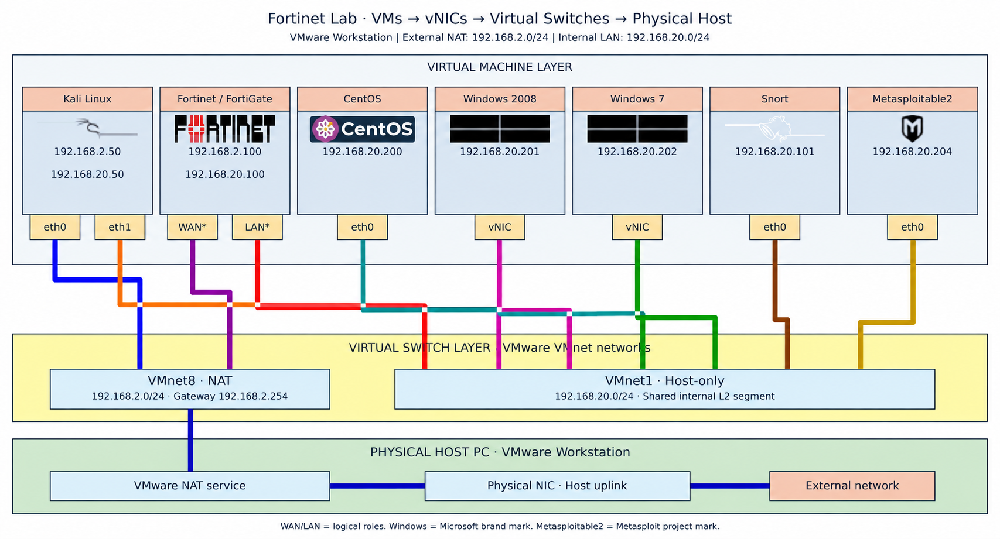
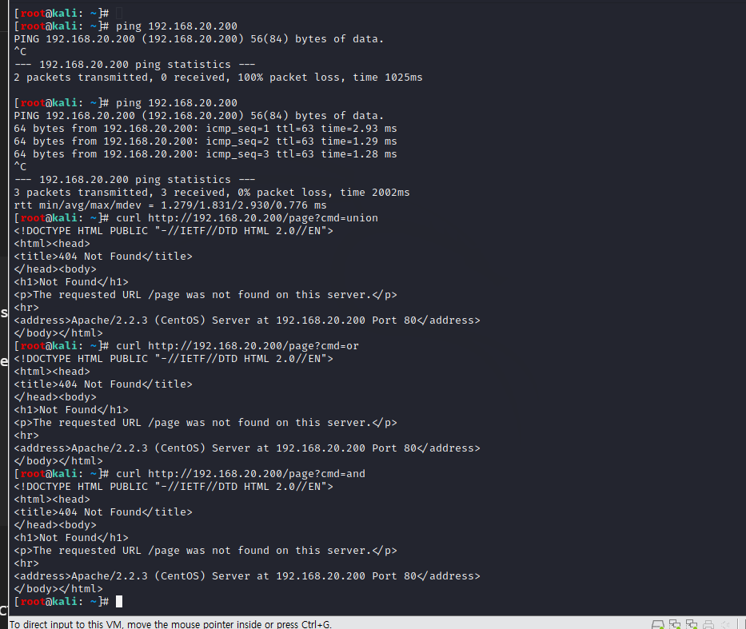
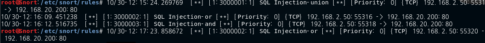
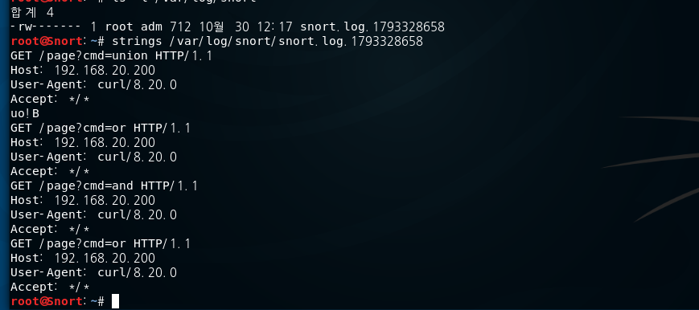
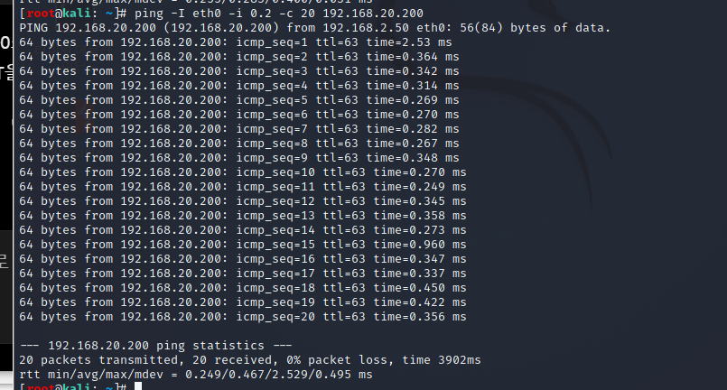
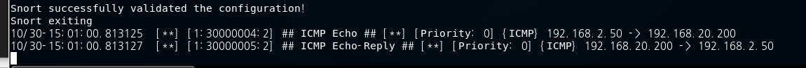
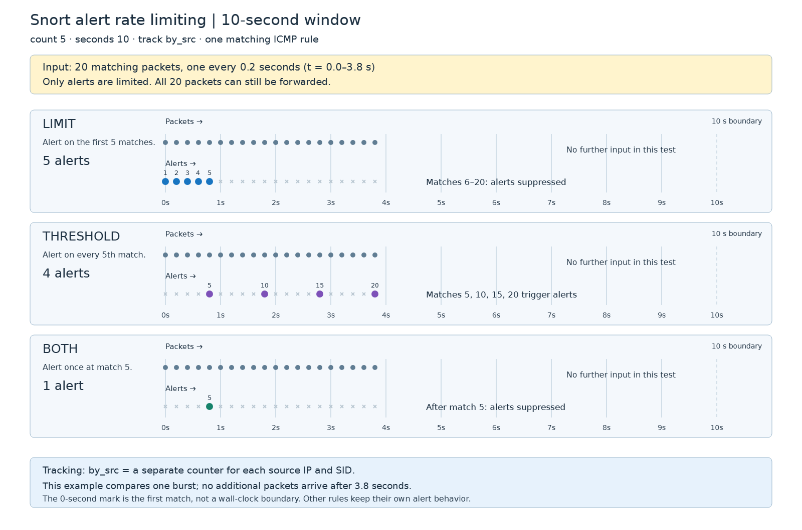
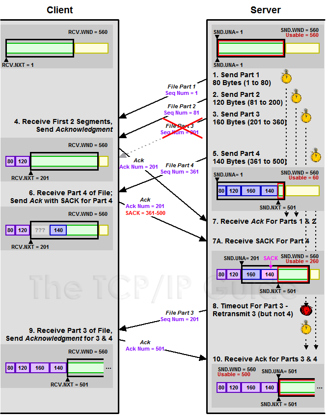

| 장비·기능 | 주요 역할 | 예시 |

| --- | --- | --- |

| 방화벽 | 구간 사이의 통신 허용·차단 | 내부 PC의 인터넷 접속 허용, 외부의 DB 접근 차단 |

| IDS | 의심스러운 트래픽 탐지·알림 | 공격 패턴 발견 후 관리자에게 경고 |

| IPS | 공격 트래픽 탐지·차단 | 취약점 공격 패킷을 통과 중 차단 |

| WAF | 웹 요청을 분석해 웹 공격 차단 | SQL Injection, XSS 요청 검사 |

| VPN 게이트웨이 | 암호화된 터널 제공 | 재택근무자와 사내망 연결 |

| NAC | 접속 단말의 신원·상태를 확인해 접근 제어 | 미등록 노트북의 사내망 접속 제한 |

| 보안 스위치 기능 | 내부 L2 공격 방어 | Port Security, DHCP Snooping, DAI |

| DDoS 방어 | 대량 공격 트래픽 완화 | 인터넷 회선을 소모하는 공격 대응 |

| 보안 프록시·SWG | 사용자의 웹 접속 중계·검사 | 악성 사이트·파일 다운로드 차단 |



### 2. 방화벽 유형 — 무엇을 기준으로 검사하는가?

| 유형 | 검사 기준 | 장점 | 한계 |

| --- | --- | --- | --- |

| 패킷 필터링 | IP, 프로토콜, 포트, 방향 | 단순하고 빠름 | 기본 ACL만으로는 연결 상태·애플리케이션 맥락 파악이 제한적 |

| 상태 기반 방화벽 | 패킷 정보와 연결 상태 | 정상 연결의 반환 트래픽을 구분 | 애플리케이션 내부 공격까지 모두 판단하지는 못함 |

| 애플리케이션 프록시 | 연결을 중계하며 애플리케이션 요청 검사 | 프로토콜 수준의 세밀한 제어 | 처리 부담·프로토콜별 지원 필요 |

| NGFW | 상태·애플리케이션·사용자·위협 정보 등 | 여러 기준을 결합한 정책 | 암호화 검사와 기능 활성화에 따라 성능·운영 복잡도 증가 |

| WAF | HTTP 요청·응답의 웹 의미 | 웹 공격에 특화 | SSH·일반 DB 접속 등 전체 네트워크 통제용은 아님 |

### 3. 패킷 필터링과 상태 기반 방화벽의 차이

내부 PC가 외부 웹 서버에 접속한다고 가정하겠습니다.

| 방향 | 출발지 | 목적지 |

| --- | --- | --- |

| 요청 | 내부 PC TCP `51000` | 웹 서버 TCP `443` |

| 응답 | 웹 서버 TCP `443` | 내부 PC TCP `51000` |

**패킷 필터링**은 요청과 응답을 각각 규칙에 대조합니다. 요청을 허용해도 반대 방향 ACL이 응답을 차단할 수 있습니다.

**상태 기반 방화벽**은 허용한 연결을 상태 테이블에 기록하고, 돌아오는 패킷이 그 연결에 속하는지 검사합니다.

| 연결 정보 예시 | 값 |

| --- | --- |

| 출발지 | `192.168.20.202:51000` |

| 목적지 | 외부 웹 서버 `:443` |

| 프로토콜 | TCP |

| 연결 상태 | 연결 진행 중·연결됨·종료 등 |

따라서 **내부에서 시작한 연결의 응답 허용**과 **외부에서 새로 시작하는 연결 차단**을 구분하기 쉽습니다.

### 4. 방화벽의 설치 구조

| 구조 | 동작 | 적용 예 |

| --- | --- | --- |

| 라우팅 모드 | 서로 다른 IP 네트워크 사이에서 라우팅·검사 | 현재 `.100.0/24 ↔ .20.0/24` |

| 투명 모드 | L2 브리지처럼 구간 사이에 삽입해 검사 | 기존 IP 구조 변경을 줄이며 방화벽 추가 |

| 호스트 방화벽 | 서버·PC 자체에서 송수신 제어 | Windows 방화벽, Linux nftables |

| 가상 방화벽 | VM 등 소프트웨어 형태로 실행 | 가상화 환경의 구간 분리 |

| 클라우드 방화벽 | 클라우드 네트워크·서비스에서 정책 적용 | 보안 그룹, 네트워크 ACL, 관리형 방화벽 |

이 분류들은 서로 겹칩니다. **가상 방화벽이 라우팅 모드로 동작하면서 상태 기반 검사를 수행**할 수 있습니다.

### 5. 일반적인 내부망·DMZ 구조

**DMZ는 외부에 공개할 서버를 내부 업무망과 분리해 놓는 구간**입니다.

| 구간 | 배치 장비·서버 | 대표 정책 |

| --- | --- | --- |

| 외부망 | 인터넷·외부 사용자 | 기본적으로 신뢰하지 않음 |

| DMZ | 공개 웹 서버·리버스 프록시 | 외부에서 HTTPS만 허용 |

| 내부 업무망 | 직원 PC·업무 서버 | 필요한 업무 통신만 허용 |

| DB 구간 | 데이터베이스 | 지정된 애플리케이션 서버만 접근 |

| 관리망 | 관리자 접속·모니터링·로그 수집 | 관리자 경로와 권한 제한 |

## snort IDS 구축

SQL Igection 탐지

```javascript
sudo tee -a /etc/snort/rules/local.rules > /dev/null <<'EOF'

# SQL Injection keyword detection
alert tcp $EXTERNAL_NET any -> $HOME_NET any (msg:"SQL Injection-union"; content:"union"; nocase; http_uri; sid:3000001; rev:1;)
alert tcp $EXTERNAL_NET any -> $HOME_NET any (msg:"SQL Injection-or"; content:"or"; nocase; http_uri; sid:3000002; rev:1;)
alert tcp $EXTERNAL_NET any -> $HOME_NET any (msg:"SQL Injection-and"; content:"and"; nocase; http_uri; sid:3000003; rev:1;)
EOF
```

kali linux —> centos 로 sql ingection



snort 머신에서 확인

snort rule에 매칭된 패킷이 있으면 경보를  콘솔을 백그라운드에서 실행

snort -q -A console -b -c /etc/snort/snort.rules &



strings /var/log/snort/snort.logs



**`type`**** 세 가지 차이**

`count 5, seconds 10`으로 설정한 경우입니다.

| type | 동작 | 10초 안에 20개가 매칭되면 |

| --- | --- | --- |

| `limit` | 처음 5개만 경고, 나머지 억제 | 경고 5회 |

| `threshold` | 5개 매칭될 때마다 경고 | 경고 4회 |

| `both` | 5개가 모이면 한 번 경고하고 남은 시간 억제 | 경고 1회 |

위 횟수는 **같은 추적 IP의 패킷을 모두 수신하고 한 시간 구간 안에 매칭된 경우**입니다. [snort-org-site.s3.amazonaws.com](https://snort-org-site.s3.amazonaws.com/production/document_files/files/000/000/249/original/snort_manual.pdf?utm_source=chatgpt.com)

```plain text
threshold: type both, track by_src, count 5, seconds 10;
```

| 옵션 | 의미 |

| --- | --- |

| `by_src` | 출발지 IP별로 집계 — Kali별 발생량 |

| `by_dst` | 목적지 IP별로 집계 — CentOS로 모이는 발생량 |

| `count` | 매칭 횟수 기준 |

| `seconds` | 집계 시간, 초 단위 |

**3. 비교용 규칙 3개 추가**

Snort에서 아래 블록을 **한 번만** 실행하세요. 기존 규칙은 유지됩니다.

```plain text
tee -a /etc/snort/rules/local.rules > /dev/null <<'EOF'

# ICMP alert rate comparison
alert icmp any any -> 192.168.20.200 any (msg:"LAB LIMIT"; itype:8; threshold:type limit, track by_src, count 5, seconds 10; sid:31000001; rev:1;)

alert icmp any any -> 192.168.20.200 any (msg:"LAB THRESHOLD"; itype:8; threshold:type threshold, track by_src, count 5, seconds 10; sid:31000002; rev:1;)

alert icmp any any -> 192.168.20.200 any (msg:"LAB BOTH"; itype:8; threshold:type both, track by_src, count 5, seconds 10; sid:31000003; rev:1;)
EOF
```

SID를 다르게 지정했으므로 세 동작을 동시에 비교할 수 있습니다. **같은 SID에 threshold를 여러 개 지정하면 안 됩니다.** [snort.org](https://www.snort.org/document/readme-thresholding?utm_source=chatgpt.com)

설정 검사:

```plain text
snort -T -c /etc/snort/snort.conf
```

기존 수동 Snort는 해당 창에서 `Ctrl+C`로 종료하고, 하나만 실행합니다.

```plain text
systemctl stop snort
snort -q -A console -i eth0 -c /etc/snort/snort.conf
```

**4. Kali에서 제한된 패킷으로 테스트**

무제한 플러딩 없이 **0.2초 간격으로 20개**만 보내도 차이를 확인할 수 있습니다.

```plain text
ping -I eth0 -i 0.2 -c 20 192.168.20.200
```





10초 구간 안에서 20개 요청을 보내도 Echo 경고 1회, Echo-Reply 경고 1회씩 발생하는것을 확인할 수 있다. 




**실습에서 주로 사용할 설정**

“짧은 시간에 반복되는 ICMP를 감지하되 경고는 적게”가 목적이면 다음과 같은 **`both`**가 적합합니다.

```plain text
threshold:type both, track by_src, count 5, seconds 10;
```

이 설정은 **10초 안에 5개가 모였을 때 경고하고 이후 경고를 억제한다. 패킷 자체를 드롭하는것이 아닌 알림을 한번만 하는것.**

**정규식 핵심 문법**

```plain text
pcre:"/정규식/iU";
```

| 표현 | 의미 | 예 |

| --- | --- | --- |

| `i` | 대소문자 무시 | `admin`, `ADMIN` |

| `U` | 정규화된 HTTP URI 검사 — Snort 2 | 경로·쿼리 검사 |

| `\b` | 단어 경계 | `or`와 `order` 구분 |

| `\s+` | 공백 1개 이상 | `union select` |

| `(?:a\|b)` | a 또는 b | `admin` 또는 `manager` |

| `[0-9]{6,12}` | 숫자 6~12개 | 긴 숫자 파라미터 |

| `^` / `$` | 검사 문자열 시작 / 끝 | 정확한 경로 조건 |

**셸에서 규칙 추가**

Snort 실행을 `Ctrl+C`로 종료한 뒤, **Snort VM에서 아래 설정을 추가한다.**

```plain text
cp -a /etc/snort/rules/local.rules \
  "/etc/snort/rules/local.rules.bak.$(date +%Y%m%d-%H%M%S)"
  

cat >> /etc/snort/rules/local.rules <<'EOF'

# 1. UNION SELECT pattern in normalized URI
alert tcp 192.168.2.50 any -> 192.168.20.200 80 (msg:"ADV SQL UNION SELECT"; flow:to_server,established; content:"union"; nocase; http_uri; pcre:"/\bunion\s+(?:all\s+)?select\b/iU"; threshold:type limit, track by_src, count 1, seconds 10; sid:32000001; rev:1;)

# 2. Numeric OR equality pattern in normalized URI
alert tcp 192.168.2.50 any -> 192.168.20.200 80 (msg:"ADV SQL OR numeric equality"; flow:to_server,established; content:"or"; nocase; http_uri; pcre:"/\bor\s+[0-9]{1,6}\s*=\s*[0-9]{1,6}\b/iU"; threshold:type limit, track by_src, count 1, seconds 10; sid:32000002; rev:1;)

# 3. Requests to selected administrative paths
alert tcp 192.168.2.50 any -> 192.168.20.200 80 (msg:"ADV Admin path access"; flow:to_server,established; pcre:"/^\/(?:admin|manager|phpmyadmin)(?:\/|\?|$)/iU"; threshold:type both, track by_src, count 3, seconds 10; sid:32000003; rev:1;)

# 4. Selected download paths with long numeric id
alert tcp 192.168.2.50 any -> 192.168.20.200 80 (msg:"ADV Long numeric download ID"; flow:to_server,established; content:"/download"; nocase; http_uri; pcre:"/^\/download(?:\.php)?\?(?:[^&]*&){0,5}id=[0-9]{6,12}(?:&|$)/iU"; threshold:type limit, track by_src, count 1, seconds 10; sid:32000004; rev:1;)

# 5. Lab marker in normalized HTTP headers
alert tcp 192.168.2.50 any -> 192.168.20.200 80 (msg:"ADV Lab header marker"; flow:to_server,established; content:"X-Lab-Test"; nocase; http_header; pcre:"/(?:^|\r\n)X-Lab-Test:\s*(?:scan|probe)-[0-9]{3}\s*(?:\r\n|$)/iH"; threshold:type threshold, track by_src, count 3, seconds 10; sid:32000005; rev:1;)
EOF
```

`content`로 후보를 먼저 좁히고 `pcre`로 조건을 정밀하게 검사하는 방식이다. PCRE는 상대적으로 처리 비용이 높으므로 사전 문자열 조건을 함께하는것이 유리하다.

아래 요청은 탐지용 문자열입니다. **웹 서버에 취약점이 없어도 요청을 관찰하면 탐지할 수 있으며, HTTP 404 응답이어도 가능합니다.**

① `UNION SELECT` — 첫 매칭에서 경고, 이후 10초 동안 추가 경고 제한:

```plain text
curl --max-time 5 -G \
  --data-urlencode 'q=union select' \
  'http://192.168.20.200/page'
```

② `OR 숫자=숫자`:

```plain text
curl --max-time 5 -G \
  --data-urlencode 'q=or 1=1' \
  'http://192.168.20.200/page'
```

이 규칙은 **숫자 비교 형태**를 탐지합니다. `1=2`도 매칭하므로 논리적으로 참인지 판단하는 규칙은 아닙니다.

③ 관리 경로 — 10초 안에 3회 매칭되면 한 번 경고:

```plain text
for n in 1 2 3; do
  curl --max-time 2 -s -o /dev/null \
    'http://192.168.20.200/admin/'
done
```

④ 긴 숫자 ID:

```plain text
curl --max-time 5 \
  'http://192.168.20.200/download?id=123456789'
```

⑤ 사용자 지정 HTTP 헤더 — 3회마다 경고:

```plain text
for n in 1 2 3; do
  curl --max-time 2 -s -o /dev/null \
    -H 'X-Lab-Test: probe-123' \
    'http://192.168.20.200/'
done
```

**5. 예상 결과와 한계**

| SID | 탐지 조건 | 경고 제한 |

| --- | --- | --- |

| `32000001` | `union [all] select` | 10초에 최대 1회 |

| `32000002` | `or 숫자=숫자` | 10초에 최대 1회 |

| `32000003` | 지정 관리 경로 접근 | 10초 안에 3회 모이면 1회 |

| `32000004` | 지정 다운로드 경로의 긴 숫자 ID | 10초에 최대 1회 |

| `32000005` | 지정 HTTP 헤더 형식 | 10초 내 매칭 3회마다 |

[https://www.tcpipguide.com/free/diagrams/tcpswretranssack.png](https://www.tcpipguide.com/free/diagrams/tcpswretranssack.png)



***A Better Solution: Selective Acknowledgment (SACK)***

It is in fact this lack of knowledge about non-contiguous segments that is the core of the problem with non-contiguous segments. The solution is to extend the basic TCP sliding window algorithm with an optional feature that allows a device to acknowledge non-contiguous segments individually. This feature, introduced in RFC 1072 and refined in RFC 2018, is called TCP *selective acknowledgment*, abbreviated *SACK*.

To use SACK, the two devices on the connection must both support the feature, and must enable it by [negotiating](https://www.tcpipguide.com/free/t_TCPConnectionEstablishmentSequenceNumberSynchroniz.htm) the *Selective Acknowledge Permitted (SACK-Permitted)* option in the *SYN* segment they use to establish the connection. Assuming this is done, either device is then permitted to include in a regular TCP segment a *Selective Acknowledgment (SACK)* option. This option contains a list of sequence number ranges of segments of data that have been received but have not been acknowledged since they are non-contiguous.

Each device modifies its retransmission queue so that each segment includes a flag that is set to 1 if the segment has been selectively acknowledged—the *SACK* bit. The device then uses a modified version of the “aggressive” method above, where upon retransmission of a segment all later segments are also retransmitted ***unless*** their SACK bits are set to 1.

For example, in our four-segment case, if the client receives Segment #4 but not Segment #3, when it sends back a segment with an *Acknowledgment Number* field value of 201 (for #1 and #2), it can include a *SACK* option that specifies “I have received bytes 361 through 500, but they are not yet acknowledged”. This can also be done in a second acknowledgment segment if Segment #4 arrives well after #1 and #2. The server recognizes this as the range of bytes for Segment #4, and turns on the *SACK* bit for Segment #4. When Segment #3 is retransmitted, the server sees the SACK bit for Segment #4 on and does not retransmit it. This is illustrated in [Figure 225](https://www.tcpipguide.com/free/t_TCPNonContiguousAcknowledgmentHandlingandSelective-4.htm#Figure_225).

After Segment #3 is retransmitted, the SACK bit for Segment #4 is cleared. This is done for robustness, to handle cases where for whatever reason the client “changes its mind” about having received Segment #4. The client ***should*** send an acknowledgment with an *Acknowledgment Number* of 501 or higher, indicating “official” receipt of Segments #3 and #4. If this does not happen, the server must receive another selective acknowledge for Segment #4 to turn its SACK bit back on. Otherwise it will be automatically re-sent when its timer expires, or when Segment #3 is retransmitted.

원본: [Notion](https://app.notion.com/p/snort-IDS-409aa16a5aa480ecb083f34ede72c1f0)
