Phase 1 확장

## Phase 1 확장 — server.c / client.c 분리 구현 및 검증 (2026-11-02)

기존 Phase 1은 서버 코드를 직접 작성하고 netcat(nc)을 클라이언트로 사용했다. 이번 확장에서는 클라이언트도 C로 직접 작성하여 각각 독립된 프로세스에서 socket → connect/accept → send/recv → close 흐름을 추적한다. 기존 소켓 학습과 캡처 자료는 그대로 유지한다.

### 1. 학습 목표와 파일 구성

- server.c: TCP 9090 포트를 열고 접속을 수락하며 수신한 바이트를 다시 전송하는 Echo Server

- client.c: 127.0.0.1:9090에 접속하고 메시지를 보내며 반환된 바이트가 동일한지 검증하는 TCP Client

- 한 번의 send()가 한 번의 recv()와 1:1 대응하지 않는 TCP 바이트 스트림 특성 확인

- 서버의 server_fd와 client_fd가 모두 서버 프로세스의 FD라는 사실 확인

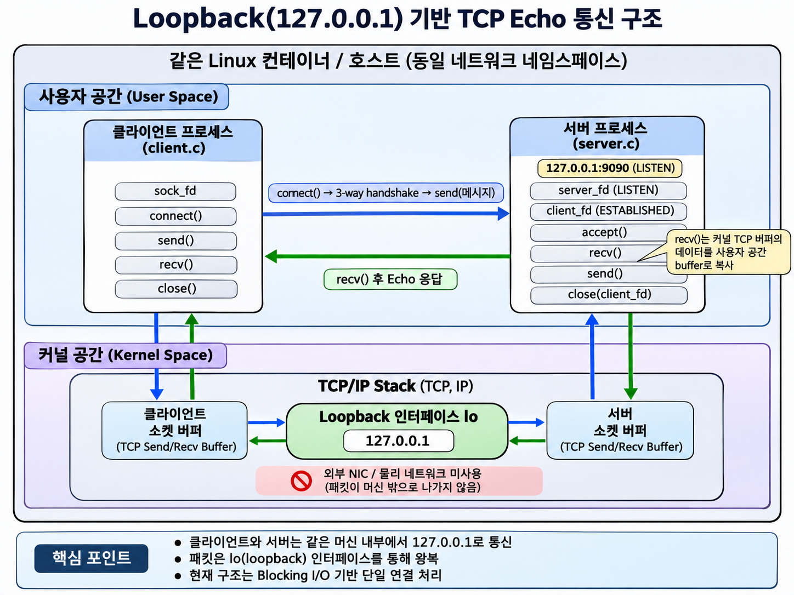

```plain text
~/projects/mini-l4-lb/phase1/
├── server.c
├── client.c
└── Makefile

클라이언트 프로세스                 서버 프로세스
client.c                           server.c
socket()                           socket()
    |                              setsockopt()
    |                              bind() -> listen()
connect() -----------------------> accept()
send(message) -------------------> recv(buffer)
recv(echo) <---------------------- send(buffer)
close()                            close(client_fd)
                                   accept() 대기로 복귀

127.0.0.1:임시포트  <---TCP--->  127.0.0.1:9090
```

기존 문서의 server.c는 INADDR_ANY(0.0.0.0)에 바인딩한다. 이번 확장 예제는 로컬 디버깅을 위해 INADDR_LOOPBACK(127.0.0.1)에 바인딩한다. 기존 환경에서 Docker 외부 접속이 필요하면 네트워크 경계와 포트 게시를 검토한 후 변경한다.

### 2. 서버와 클라이언트가 갖는 FD 비교

| 소유 프로세스 | 변수 | 생성 API | 역할 |
| --- | --- | --- | --- |
| 서버 | server_fd | socket() | LISTEN 소켓, 새 연결 수락용 |
| 서버 | client_fd | accept() | 특정 클라이언트와 실제 송수신용 |
| 클라이언트 | sock_fd | socket() | connect() 이후 서버와 송수신용 |

### 3. server.c — Blocking TCP Echo Server 전체 코드

```c

/*
 * ============================================================
 * Mini L4 Load Balancer - Phase 1
 * Blocking TCP Echo Server (Debug Version)
 * ============================================================
 *
 * 학습 목표
 * 1. Socket API 호출 흐름 이해
 * 2. C 포인터, 구조체, 배열 이해
 * 3. Host / Network Byte Order 비교
 * 4. recv()의 실제 수신 크기 관찰
 * 5. send()의 부분 전송 처리 이해
 * 6. GDB / Wireshark / tcpdump 디버깅
 *
 * TCP Server:
 *   0.0.0.0:9090
 *
 * Client:
 *   nc 127.0.0.1 9090
 */

#include <stdio.h>
#include <stdlib.h>
#include <string.h>
#include <stdint.h>
#include <errno.h>
#include <unistd.h>
#include <signal.h>

#include <arpa/inet.h>
#include <sys/socket.h>

/* =========================
 * 상수 정의
 * ========================= */

#define SERVER_PORT 9090
#define BUFFER_SIZE 4096
#define BACKLOG 128
#define HEX_PREVIEW_SIZE 64


/* ============================================================
 * print_hex()
 *
 * 지정된 메모리 영역을 16진수 바이트로 출력한다.
 *
 * const void *data:
 *   임의 자료형의 메모리 주소를 전달받는다.
 *
 * size_t length:
 *   출력할 바이트 수
 *
 * unsigned char *:
 *   메모리를 1바이트 단위로 읽기 위한 포인터
 * ============================================================ */

static void print_hex(
    const void *data,
    size_t length
)
{
    const unsigned char *p =
        (const unsigned char *)data;

    for (size_t i = 0; i < length; i++) {

        printf("%02X ", p[i]);

        // 16바이트마다 줄바꿈
        if ((i + 1) % 16 == 0) {
            printf("\n");
        }
    }

    if (length % 16 != 0) {
        printf("\n");
    }
}


/* ============================================================
 * main()
 * ============================================================ */

int main(void)
{
    /*
     * 파일 디스크립터
     *
     * server_fd:
     *   TCP LISTEN 소켓
     *
     * client_fd:
     *   accept()가 반환하는 연결 소켓
     */
    int server_fd = -1;
    int client_fd = -1;

    // SO_REUSEADDR 옵션 활성화에 사용할 정수
    int opt = 1;

    /*
     * IPv4 주소 구조체
     *
     * sockaddr_in:
     *   sin_family
     *   sin_port
     *   sin_addr
     *   sin_zero
     */
    struct sockaddr_in server_addr;
    struct sockaddr_in client_addr;

    /*
     * 사용자 공간 수신 버퍼
     *
     * char: 1바이트
     * buffer[4096]: 총 4096바이트
     */
    char buffer[BUFFER_SIZE];

    /*
     * SIGPIPE 무시
     *
     * 상대방이 연결을 종료한 뒤 send()하면
     * SIGPIPE가 발생할 수 있다.
     *
     * SIG_IGN으로 무시하고
     * send() 반환값을 통해 오류를 처리한다.
     */
    signal(SIGPIPE, SIG_IGN);


    /* ========================================================
     * STEP 1. TCP Socket 생성
     * ======================================================== */

    printf("\n[STEP 1] socket()\n");

    /*
     * AF_INET:
     *   IPv4
     *
     * SOCK_STREAM:
     *   바이트 스트림 소켓
     *
     * protocol = 0:
     *   AF_INET + SOCK_STREAM의 기본 프로토콜인 TCP
     *
     * 성공:
     *   0 이상의 FD 반환
     *
     * 실패:
     *   -1 반환
     */

    // [BP-1] socket() 호출 직전
    server_fd = socket(
        AF_INET,
        SOCK_STREAM,
        0
    );

    // [BP-2] socket() 호출 직후
    if (server_fd == -1) {
        perror("socket");
        return EXIT_FAILURE;
    }

    printf("[SOCKET] server_fd = %d\n", server_fd);


    /* ========================================================
     * STEP 2. SO_REUSEADDR 설정
     * ======================================================== */

    printf("\n[STEP 2] setsockopt()\n");

    /*
     * &opt:
     *   opt 변수의 메모리 주소
     *
     * sizeof(opt):
     *   opt 변수의 크기
     *
     * SO_REUSEADDR:
     *   특정 조건에서 로컬 주소 재사용 허용
     */

    if (setsockopt(
            server_fd,
            SOL_SOCKET,
            SO_REUSEADDR,
            &opt,
            sizeof(opt)
        ) == -1) {

        perror("setsockopt");
        close(server_fd);
        return EXIT_FAILURE;
    }

    printf("[SOCKET OPTION] SO_REUSEADDR = %d\n", opt);

    print_hex(
        "unused",
        0
    ); // 길이 0이므로 실제 바이트 출력 없음

    printf("[SOCKET OPTION] opt memory: ");
    print_hex(&opt, sizeof(opt));


    /* ========================================================
     * STEP 3. sockaddr_in 초기화
     * ======================================================== */

    printf("\n[STEP 3] sockaddr_in initialization\n");

    /*
     * memset()
     *
     * &server_addr:
     *   구조체 시작 주소
     *
     * 0:
     *   모든 바이트를 0x00으로 초기화
     *
     * sizeof(server_addr):
     *   구조체 전체 크기
     */

    // [BP-3] memset() 호출 직전
    memset(
        &server_addr,
        0,
        sizeof(server_addr)
    );

    // [BP-4] memset() 호출 직후
    printf("[MEMSET] sockaddr_in size = %zu bytes\n",
           sizeof(server_addr));

    printf("[MEMSET] server_addr address = %p\n",
           (void *)&server_addr);

    printf("[MEMSET] raw bytes:\n");
    print_hex(
        &server_addr,
        sizeof(server_addr)
    );


    /* ========================================================
     * STEP 4. 주소 체계 설정
     * ======================================================== */

    printf("\n[STEP 4] AF_INET\n");

    /*
     * . 연산자:
     *   구조체 멤버 접근
     *
     * sin_family:
     *   주소 체계 지정
     */

    server_addr.sin_family = AF_INET;

    printf("[AF_INET] sin_family = %d\n",
           server_addr.sin_family);

    printf("[AF_INET] raw sockaddr bytes:\n");
    print_hex(
        &server_addr,
        sizeof(server_addr)
    );


    /* ========================================================
     * STEP 5. htons() - 포트 바이트 순서 변환
     * ======================================================== */

    printf("\n[STEP 5] htons()\n");

    /*
     * uint16_t:
     *   부호 없는 16비트 정수
     *
     * htons():
     *   Host TO Network Short
     *
     * 포트 9090:
     *   10진수 = 9090
     *   16진수 = 0x2382
     */

    uint16_t host_port = SERVER_PORT;

    // [BP-5] htons() 호출 직전
    uint16_t network_port = htons(host_port);

    // [BP-6] htons() 호출 직후
    printf("[PORT] host_port = %u (0x%04X)\n",
           (unsigned)host_port,
           (unsigned)host_port);

    printf("[PORT] network_port integer = 0x%04X\n",
           (unsigned)network_port);

    printf("[PORT] Host bytes:\n");
    print_hex(
        &host_port,
        sizeof(host_port)
    );

    printf("[PORT] Network bytes:\n");
    print_hex(
        &network_port,
        sizeof(network_port)
    );

    server_addr.sin_port = network_port;


    /* ========================================================
     * STEP 6. htonl() - IP 바이트 순서 변환
     * ======================================================== */

    printf("\n[STEP 6] htonl()\n");

    /*
     * INADDR_ANY:
     *   0.0.0.0
     *
     * htonl():
     *   Host TO Network Long
     *
     * INADDR_ANY는 0이므로
     * 변환 전후 바이트가 모두 0이다.
     */

    uint32_t host_ip = INADDR_ANY;

    // [BP-7] htonl() 호출 직전
    uint32_t network_ip = htonl(host_ip);

    // [BP-8] htonl() 호출 직후
    printf("[IP] Host bytes:\n");
    print_hex(
        &host_ip,
        sizeof(host_ip)
    );

    printf("[IP] Network bytes:\n");
    print_hex(
        &network_ip,
        sizeof(network_ip)
    );

    /*
     * htonl()의 실제 바이트 변화 관찰용
     *
     * 192.168.1.10 = 0xC0A8010A
     *
     * 실제 bind 주소에는 사용하지 않는다.
     */

    uint32_t test_host_ip = 0xC0A8010A;
    uint32_t test_network_ip = htonl(test_host_ip);

    printf("[IP TEST] 192.168.1.10 Host bytes:\n");
    print_hex(
        &test_host_ip,
        sizeof(test_host_ip)
    );

    printf("[IP TEST] 192.168.1.10 Network bytes:\n");
    print_hex(
        &test_network_ip,
        sizeof(test_network_ip)
    );

    server_addr.sin_addr.s_addr = network_ip;


    /* ========================================================
     * STEP 7. 최종 sockaddr_in 구조체 출력
     * ======================================================== */

    printf("\n[STEP 7] Final sockaddr_in\n");

    printf("[ADDRESS] 0.0.0.0:%d\n", SERVER_PORT);

    printf("[STRUCT] raw bytes:\n");
    print_hex(
        &server_addr,
        sizeof(server_addr)
    );


    /* ========================================================
     * STEP 8. bind()
     * ======================================================== */

    printf("\n[STEP 8] bind()\n");

    /*
     * bind():
     *   로컬 IP/Port를 소켓에 지정
     *
     * (struct sockaddr *)&server_addr:
     *   sockaddr_in *를 sockaddr *로 형변환
     *
     * sizeof(server_addr):
     *   주소 구조체 크기
     */

    // [BP-9] bind() 호출 직전
    if (bind(
            server_fd,
            (struct sockaddr *)&server_addr,
            sizeof(server_addr)
        ) == -1) {

        perror("bind");
        close(server_fd);
        return EXIT_FAILURE;
    }

    printf("[BIND] success\n");


    /* ========================================================
     * STEP 9. listen()
     * ======================================================== */

    printf("\n[STEP 9] listen()\n");

    /*
     * listen():
     *   TCP 소켓을 LISTEN 상태로 전환
     *
     * BACKLOG:
     *   accept()를 기다리는 완료된 연결의
     *   대기열 크기 요청값
     *
     * 성공: 0
     * 실패: -1
     *
     * 새로운 FD를 반환하지 않는다.
     */

    // [BP-10] listen() 호출 직전
    if (listen(server_fd, BACKLOG) == -1) {

        perror("listen");
        close(server_fd);
        return EXIT_FAILURE;
    }

    printf("[LISTEN] server_fd = %d\n", server_fd);
    printf("[LISTEN] backlog = %d\n", BACKLOG);
    printf("[SERVER] Listening on port %d\n", SERVER_PORT);


    /* ========================================================
     * STEP 10. 클라이언트 연결 처리
     * ======================================================== */

    while (1) {

        /*
         * accept()는 주소 버퍼의 길이를
         * 입력받고 실제 주소 길이를 반환한다.
         */
        socklen_t client_len = sizeof(client_addr);

        printf("\n[ACCEPT] Waiting for client...\n");

        /*
         * accept():
         *   완료된 TCP 연결을 수락
         *
         * 연결이 없으면 블로킹
         *
         * 성공:
         *   새로운 client_fd 반환
         *
         * server_fd는 계속 LISTEN 상태 유지
         */

        // [BP-11] accept() 호출 직전
        client_fd = accept(
            server_fd,
            (struct sockaddr *)&client_addr,
            &client_len
        );

        // [BP-12] accept() 호출 직후
        if (client_fd == -1) {

            if (errno == EINTR) {
                continue;
            }

            perror("accept");
            break;
        }

        printf("[CONNECT] client_fd = %d\n", client_fd);

        printf("[CONNECT] %s:%u\n",
               inet_ntoa(client_addr.sin_addr),
               (unsigned)ntohs(client_addr.sin_port));


        /* ====================================================
         * STEP 11. 연결별 디버깅 카운터
         * ==================================================== */

        size_t total_received = 0;
        size_t total_sent = 0;

        unsigned long recv_count = 0;
        unsigned long send_count = 0;


        /* ====================================================
         * STEP 12. recv() / send() Echo 처리
         * ==================================================== */

        while (1) {

            printf("\n[DEBUG] Waiting for recv()...\n");

            /*
             * recv():
             *   커널 TCP 수신 데이터를
             *   사용자 공간 buffer로 복사
             *
             * sizeof(buffer) = 4096
             *
             * 한 번에 최대 4096바이트 요청
             *
             * 반환:
             *   > 0 : 실제 수신 바이트
             *   = 0 : EOF
             *   < 0 : 오류
             */

            // [BP-13] recv() 호출 직전
            ssize_t received = recv(
                client_fd,
                buffer,
                sizeof(buffer),
                0
            );

            // [BP-14] recv() 호출 직후
            if (received == 0) {
                printf("[DISCONNECT] Client closed write side\n");
                break;
            }

            if (received < 0) {

                if (errno == EINTR) {
                    continue;
                }

                perror("recv");
                break;
            }

            recv_count++;
            total_received += (size_t)received;

            printf("\n========== RECV DEBUG ==========\n");

            printf("recv call         : %lu\n", recv_count);
            printf("client_fd         : %d\n", client_fd);
            printf("buffer capacity   : %zu bytes\n",
                   sizeof(buffer));
            printf("received          : %zd bytes\n", received);
            printf("total received    : %zu bytes\n",
                   total_received);

            printf("buffer address    : %p\n",
                   (void *)buffer);

            printf("buffer end        : %p\n",
                   (void *)(buffer + sizeof(buffer)));

            /*
             * 실제 받은 데이터 중
             * 최대 64바이트만 출력
             */
            size_t preview = (size_t)received;

            if (preview > HEX_PREVIEW_SIZE) {
                preview = HEX_PREVIEW_SIZE;
            }

            printf("payload preview   : %zu bytes\n", preview);
            print_hex(buffer, preview);

            printf("================================\n");


            /* ================================================
             * STEP 13. send() Echo
             * ================================================ */

            /*
             * sent:
             *   현재 recv 청크에서 이미 처리한 바이트 수
             *
             * send()는 요청한 크기보다
             * 적은 바이트만 처리할 수 있으므로 반복
             */

            size_t sent = 0;

            while (sent < (size_t)received) {

                /*
                 * remaining:
                 *   아직 보내지 않은 바이트 수
                 *
                 * buffer + sent:
                 *   아직 보내지 않은 데이터 시작 주소
                 */
                size_t remaining =
                    (size_t)received - sent;

                printf("\n[DEBUG] Before send()\n");
                printf("send offset       : %zu\n", sent);
                printf("remaining bytes   : %zu\n", remaining);
                printf("send address      : %p\n",
                       (void *)(buffer + sent));

                // [BP-15] send() 호출 직전
                ssize_t n = send(
                    client_fd,
                    buffer + sent,
                    remaining,
                    0
                );

                // [BP-16] send() 호출 직후
                if (n > 0) {

                    sent += (size_t)n;
                    total_sent += (size_t)n;
                    send_count++;

                    printf(
                        "[SEND] call=%lu, sent=%zd, "
                        "chunk_progress=%zu/%zd, total=%zu\n",
                        send_count,
                        n,
                        sent,
                        received,
                        total_sent
                    );
                }
                else if (n < 0 && errno == EINTR) {
                    continue;
                }
                else {

                    if (n < 0) {
                        perror("send");
                    }
                    else {
                        fprintf(stderr, "send returned 0\n");
                    }

                    goto close_client;
                }
            }
        }


        /* ====================================================
         * STEP 14. 클라이언트 연결 종료
         * ==================================================== */

close_client:

        printf("\n========== CONNECTION SUMMARY ==========\n");
        printf("recv calls        : %lu\n", recv_count);
        printf("send calls        : %lu\n", send_count);
        printf("total received    : %zu bytes\n", total_received);
        printf("total sent        : %zu bytes\n", total_sent);
        printf("========================================\n");

        // [BP-17] close() 호출 직전
        close(client_fd);

        printf("[CLOSE] client_fd = %d closed\n", client_fd);
    }


    /* ========================================================
     * STEP 15. 서버 소켓 종료
     * ======================================================== */

    close(server_fd);

    return EXIT_SUCCESS;
}

```

서버는 단일 스레드의 Blocking 서버이므로 현재 연결된 클라이언트가 종료하기 전에는 다음 연결을 애플리케이션 코드에서 즉시 처리할 수 없다. server_fd는 계속 LISTEN 상태로 남고, accept()에서 반환한 client_fd만 클라이언트별로 닫는다.

### 4. client.c — 메시지 송신 및 Echo 검증 전체 코드

```c
#define _POSIX_C_SOURCE 200809L

#include <stdio.h>
#include <stdlib.h>
#include <string.h>
#include <unistd.h>
#include <signal.h>
#include <errno.h>
#include <arpa/inet.h>
#include <sys/socket.h>
#include <netinet/in.h>

#define SERVER_IP "127.0.0.1"
#define SERVER_PORT 9090
#define BUFFER_SIZE 4096

int main(int argc, char *argv[]) {
    int sock_fd;
    struct sockaddr_in server_addr;
    char buffer[BUFFER_SIZE];

    const char *message = argc > 1
                        ? argv[1] : "Hello TCP Echo Server!";
    size_t message_len = strlen(message);

    if (message_len == 0) {
        fprintf(stderr, "Message must not be empty\n");
        return EXIT_FAILURE;
    }

    signal(SIGPIPE, SIG_IGN);

    // 1. 클라이언트 TCP 소켓 생성
    sock_fd = socket(AF_INET, SOCK_STREAM, 0);
    if (sock_fd == -1) {
        perror("socket");
        return EXIT_FAILURE;
    }

    // 2. 서버 목적지 127.0.0.1:9090 설정
    memset(&server_addr, 0, sizeof(server_addr));
    server_addr.sin_family = AF_INET;
    server_addr.sin_port = htons(SERVER_PORT);
    if (inet_pton(AF_INET, SERVER_IP,
                  &server_addr.sin_addr) != 1) {
        fprintf(stderr, "Invalid server IP\n");
        close(sock_fd);
        return EXIT_FAILURE;
    }

    // 3. TCP 연결 요청
    if (connect(sock_fd, (struct sockaddr *)&server_addr,
                sizeof(server_addr)) == -1) {
        perror("connect");
        close(sock_fd);
        return EXIT_FAILURE;
    }

    printf("[CLIENT] Connected to %s:%d\n",
           SERVER_IP, SERVER_PORT);

    // 4. 메시지가 전부 전달될 때까지 send() 반복
    size_t sent = 0;
    while (sent < message_len) {
        ssize_t n = send(sock_fd, message + sent,
                         message_len - sent, 0);
        if (n < 0 && errno == EINTR) continue;
        if (n <= 0) {
            if (n < 0) perror("send");
            close(sock_fd);
            return EXIT_FAILURE;
        }
        sent += (size_t)n;
    }

    printf("[CLIENT] Sent %zu bytes\n", sent);

    // 5. Echo 길이만큼 수신하며 원본과 바이트 비교
    size_t total_received = 0;
    while (total_received < message_len) {
        size_t remaining = message_len - total_received;
        size_t chunk = remaining < sizeof(buffer)
                     ? remaining : sizeof(buffer);

        ssize_t n = recv(sock_fd, buffer, chunk, 0);
        if (n < 0 && errno == EINTR) continue;
        if (n <= 0) {
            if (n < 0) perror("recv");
            else fprintf(stderr, "Unexpected EOF\n");
            close(sock_fd);
            return EXIT_FAILURE;
        }

        if (memcmp(buffer, message + total_received,
                   (size_t)n) != 0) {
            fprintf(stderr, "[CLIENT] Echo mismatch\n");
            close(sock_fd);
            return EXIT_FAILURE;
        }
        total_received += (size_t)n;
    }

    printf("[CLIENT] Received %zu bytes\n", total_received);
    printf("[CLIENT] Echo verified: %s\n", message);

    // 6. 연결 해제
    close(sock_fd);
    return EXIT_SUCCESS;
}
```

client.c의 sock_fd는 클라이언트 프로세스의 독립적인 FD이다. 클라이언트는 한 번 전송 후 응답을 검증하고 종료하며, 이 구현은 테스트 문자열의 바이트 길이를 알고 있기 때문에 그만큼 recv()를 반복할 수 있다. 일반적인 TCP 애플리케이션은 별도의 프레이밍 규약(길이 필드 또는 구분자 등)이 필요할 수 있다.

### 6. GDB: connect() / accept()와 send() / recv() 연결 관찰

먼저 tcp 서버 프로그램을 띄운다. 

./server

다른 터미널에서 클라이언트 실행:

```bash
./client "Hello TCP!"
```

- 서버의 accept() 호출 전에 대기하는 시점과 실제 연결이 수락된 직후를 구별한다.

- GDB에서 라이브러리 함수에 건 중단점은 함수 진입을 멈춘다. 반환값(client_fd 등)을 확인하려면 호출 직후 소스 줄로 이동하거나 finish를 사용한다.

- 같은 코드의 여러 프로세스 FD 숫자가 같아도 각 프로세스의 독립 FD 테이블이다.

- 서버에서 하나의 클라이언트 연결을 처리하는 도중 다음 클라이언트를 실행하면 Blocking 서버의 순차 처리 특성을 확인할 수 있다.

### 8. Linux 커널 소켓과 패킷 관찰

```bash
# LISTEN 상태와 포트 확인
ss -lntp '( sport = :9090 )'

# 연결 중인 TCP 상태 확인 (순간적으로 사라질 수 있음)
ss -tnp '( sport = :9090 or dport = :9090 )'

# 프로세스의 FD 목록
pidof server
ls -l /proc/$(pidof server)/fd/

# loopback(127.0.0.1) 패킷 캡처
sudo tcpdump -i lo -nn -X 'tcp port 9090'
```

캡처 위치는 lo 인터페이스다. 클라이언트와 서버가 같은 Docker 컨테이너(같은 네트워크 네임스페이스)에서 127.0.0.1로 통신하기 때문이다.

Wireshark Display Filter 

```plain text
tcp.port == 9090
tcp.flags.syn == 1 && tcp.flags.ack == 0
tcp.flags.fin == 1
tcp.len > 0
```

관찰 순서: SYN → SYN/ACK → ACK → 데이터 전송 및 Echo → FIN/ACK 종료 흐름. 다만 패킷 분할, ACK 합쳐짐, TCP 옵션 및 운영체제 동작에 따라 캡처 형태는 달라질 수 있다.

### 9. 자주 혼동하는 개념과 정정 메모

| 혼동 | 올바른 이해 |
| --- | --- |
| 서버의 client_fd = 클라이언트의 sock_fd | 두 FD는 서로 다른 프로세스의 정수 핸들 |
| accept()가 3-way handshake를 직접 실행 | TCP handshake는 주로 커널 TCP 스택에서 처리되고, accept()는 완료된 연결을 큐에서 가져옴 |
| accept()가 LISTEN FD를 꺼내 제거 | 원래 LISTEN 소켓은 남고 별도 연결 FD가 반환됨 |
| send() 성공 = 상대 프로세스가 수신 완료 | send() 성공은 로컬 송신 경로에 바이트가 받아들여졌음을 뜻하며 상대 앱 수신 보장은 아님 |
| recv() 한 번 = send() 한 번 | TCP는 메시지 경계가 없는 바이트 스트림 |
| close()를 하면 항상 RST가 전송 | 일반적인 정상 종료는 FIN을 사용하며 RST 여부는 소켓 상태·읽지 않은 데이터·옵션에 따름 |
| recv()가 0 반환 = 소켓이 이미 닫힘 | 상대의 송신 방향 종료(EOF)를 의미하며 로컬에서 close()를 따로 호출해야 함 |

이제 코드 흐름을 따라서 살펴본다. 이전 Phase1에서는 한 코드에 client와 server 코드가 혼재되어 있어 역할 구분이 어려웠다. 코드를 명확하게 client, server로 나누고 독립적인 프로세스로 동작하게 한다. 이후에는 다른 client container를 추가해서 다른 네트워크 네임스페이스에서 통신하는것도 살펴본다.

또한 클라이언트와 서버 흐름을 동시에 gdb로 디버깅할 수 있게 vscode에 아래 launch.json 코드 설정을 추가한다. 각각 별도로 컴파일했기 때문에 main 함수가 두 개 존재해도 문제 없다.

launch.json

```c

{
  "version": "0.2.0",
  "configurations": [
    {
      "name": "Debug Server",
      "type": "cppdbg",
      "request": "launch",
      "program": "${workspaceFolder}/server",
      "args": [],
      "cwd": "${workspaceFolder}",
      "stopAtEntry": false,
      "MIMode": "gdb",
      "miDebuggerPath": "/usr/bin/gdb",
      "externalConsole": false
    },
    {
      "name": "Debug Client",
      "type": "cppdbg",
      "request": "launch",
      "program": "${workspaceFolder}/client",
      "args": ["Hello TCP!"],
      "cwd": "${workspaceFolder}",
      "stopAtEntry": false,
      "MIMode": "gdb",
      "miDebuggerPath": "/usr/bin/gdb",
      "externalConsole": false
    }
  ],
  "compounds": [
    {
      "name": "Debug TCP Client + Server",
      "configurations": [
        "Debug Server",
        "Debug Client"
      ],
      "stopAll": true
    }
  ]
}

```

```c
gcc -O0 -g3 server.c -o server
gcc -O0 -g3 client.c -o client
```

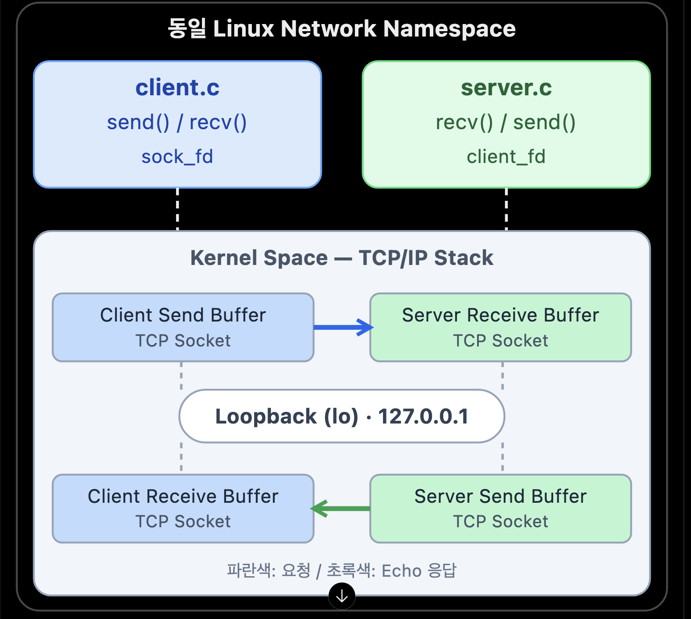

### 1. server ip, port socket fd, recv, send bufferr 초기화

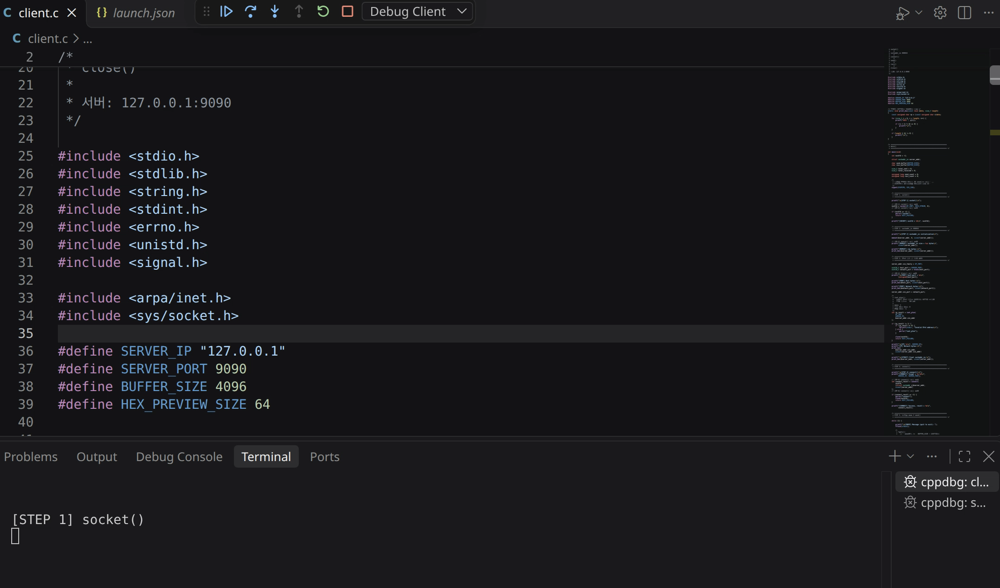

| 변수 | 자료형 | 역할 |
| --- | --- | --- |
| server_addr | struct sockaddr_in | 연결할 서버의 IPv4 주소와 포트 |
| send_buffer | char[] | 서버에 전송할 데이터를 보관하는 사용자 공간 버퍼 |
| recv_buffer | char[] | 서버에서 수신한 데이터를 보관하는 사용자 공간 버퍼 |
| total_sent | size_t | 지금까지 전송한 총 바이트 수. 메모리 크기나 바이트 수를 표현하기 위한 부호 없는 정수형 |
| total_received | size_t | 지금까지 수신한 총 바이트 수 |
| send_count | unsigned long | send() 횟수를 기록하기 위한 변수. 현재 os는 linux이므로 8바이트 |
| recv_count | unsigned long | recv() 호출 횟수를 기록하기 위한 변수 |

송수신 버퍼는 유저 공간의 버퍼이지 커널 tcp 스택의 버퍼가 아니다.

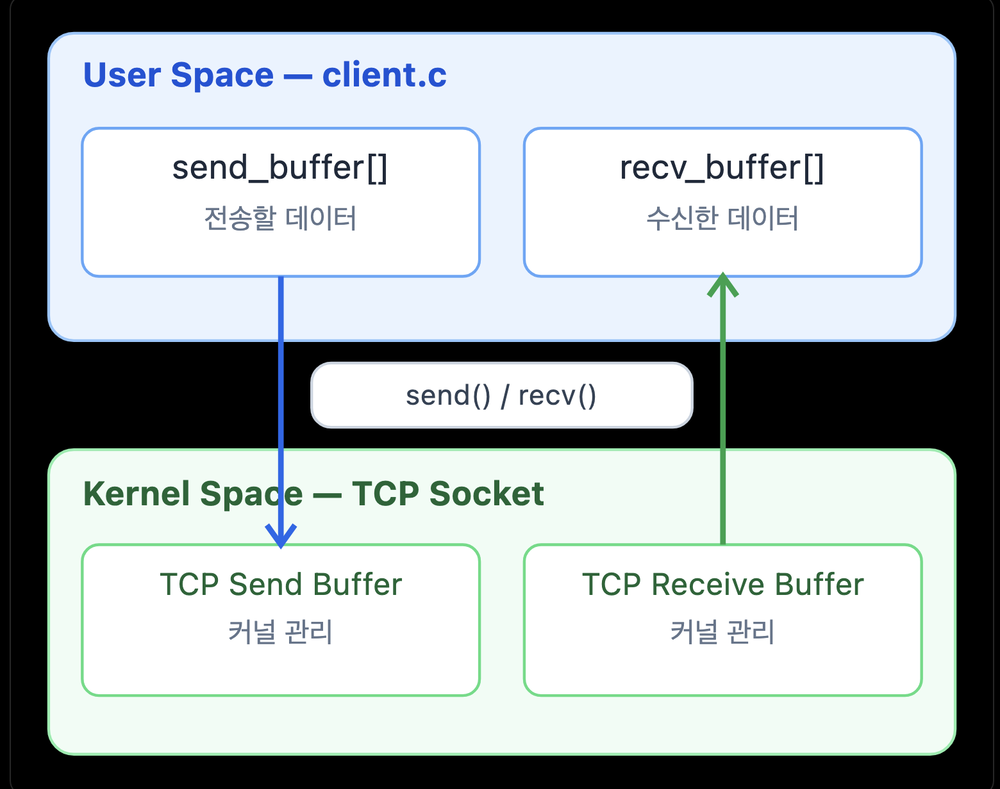

send(sock_fd, send_buffer, 100, 0); 는 사용자 공간에서 커널 공간의 버퍼로 데이터를 복사하는것이고, recv(sock_fd, recv_buffer, 100, 0);은 커널 수신버퍼에서 사용자 공간의 버퍼로 데이터를 복사해오는것이다. 

### 2. socket () 시스템 콜 호출

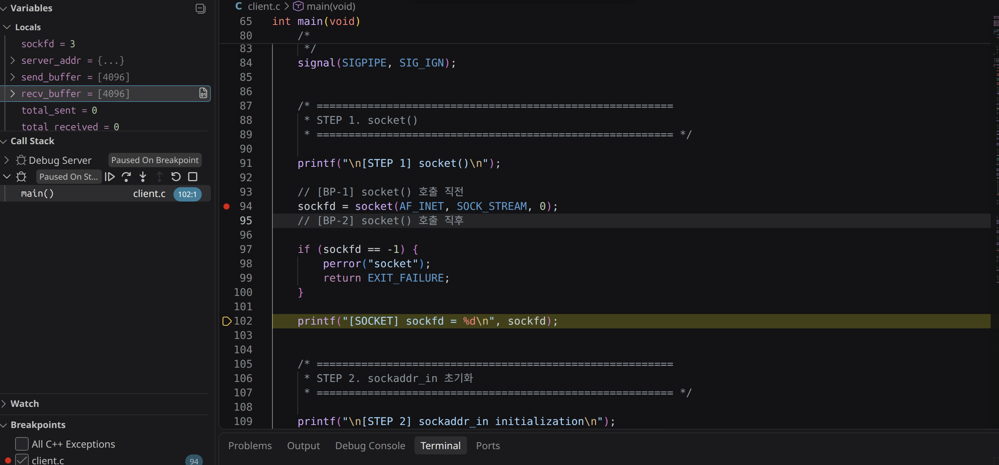

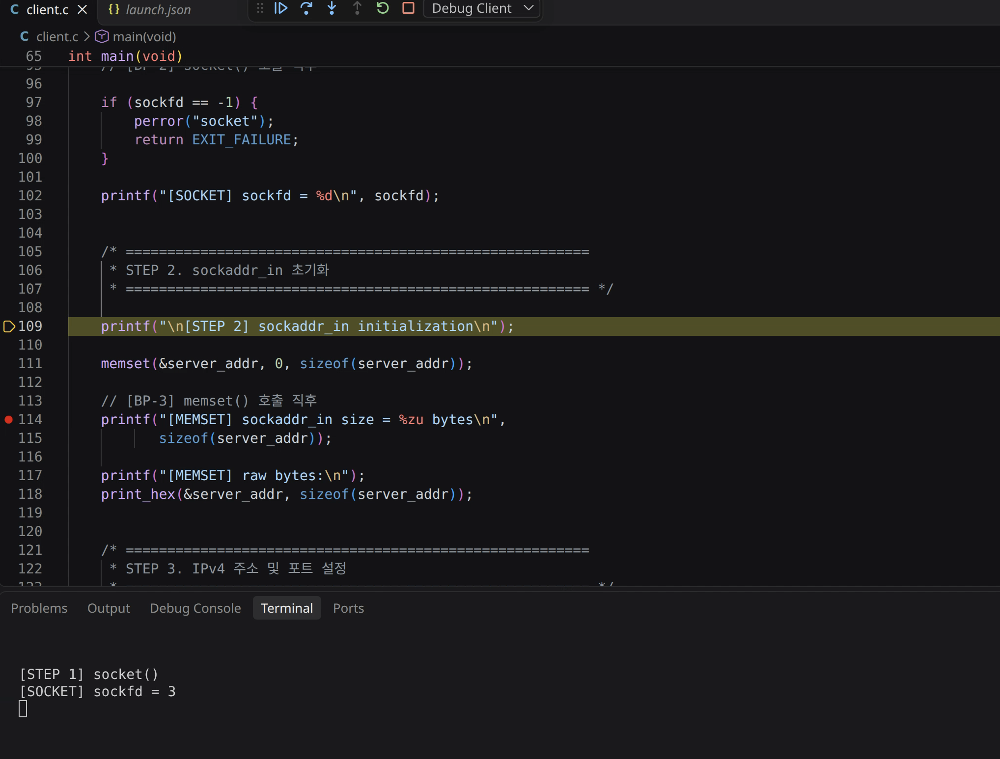

sockfd = socket(AF_INET, SOCK_STREAM, 0); 를 호출. Linux 커널에 IPv4 기반 TCP 소켓 생성을 요청하고, 생성된 소켓을 참조하는 파일 디스크립터(FD)를 sock_fd 에 저장(현재는 3)

다시 정리하면 socket 호출에는 AF_INET(IPv4), SOCK_STREAM(연결지향 바이트 스트림 소켓), 0(앞선 인자들의 조합에 맞는 기본 프로토콜 선택)

커널의 소켓 api 함수 선언은 다음과 같다. 

int socket(int domain, int type, int protocol);

세 인자는 모두 `int` 자료형이지만, 아무 정수나 넣는 것이 아니라 운영체제가 정의한 상수와 올바른 조합을 사용해야 한다.

첫번째 인자인 domain은 통신 주소 체계를 의미한다. 여기에는 IPv4, IPv6, Unix domain socket등이 올 수 있다. domain은 어떤 주소 체계가 올지 결정한다.

| 상수 | 의미 | 용도 |
| --- | --- | --- |
| AF_INET | IPv4 | IPv4 TCP/UDP 통신 |
| AF_INET6 | IPv6 | IPv6 TCP/UDP 통신 |
| Unix Domain Socket | Unix Domain socket | 같은 호스트 내부 프로세스 통신 |
| AF_PACKET | Packet Socket | Linux L2 패킷 송수신 |
| AF_NETLINK | Netlink Socket | 사용자 공간과 Linux 커널 간 정보 교환 |
| AF_BLUETOOTH | Bluetooth | 블루투스 통신 |
| AF_VSOCK | VSOCK | 호스트와 가상머신간 통신 |

현재 클라이언트와 서버는 아래와 같이 주소가 설정된다.여기서 127.0.0.1 은 IPv4 Loopback 주소이다.

127.0.0.1:53000 → 127.0.0.1:9090

같은 머신 내에서만 통신한다면 domain 인자에 AF_UNIX가 들어갈수도 있다. 이 경우에는 127.0.0.1 대신 /tmp/echo.sock 같은 파일시스템 경로를 주소로 사용할 수 있다. 다만 AF_UNIX 와 AF_INET 은 주소 체계가 다르므로 소켓 주소 구조체도 달라진다.

두 번째 인자인 type은 소켓이 어떤 방식으로 데이터를 주고받을지 결정한다.

| 상수 | 의미 | 특징 |
| --- | --- | --- |
| SOCK_STREAM | 스트림 소켓 | 연결 지향, 바이트 스트림 |
| SOCK_DGRAM | 데이터그램 소켓 | 메시지 단위 송수신 |
| SOCK_RAW | Raw Socket | 프로토콜 헤더를 포함한 저수준 통신 |
| SOCK_SEQPACKET | 순서 있는 패킷 소켓 | 연결 지향, 메시지 경계 보존 |
| SOCK_RDM | Reliable Datagram | 신뢰성 있는 데이터그램 유형, 지원 제한적 |

UDP의 경우 SOCK_DGRAM이 들어갈 수 있다. 또한 리눅스에서는 생성 시점부터 Non-blocking을 결정할수도 있다.


socket(AF_INET, SOCK_STREAM \| SOCK_NONBLOCK, 0);

세번째 인자인 protocol은 protocol을 지정한다.

| 상수 | 일반적인 값 | 의미 |
| --- | --- | --- |
| 0 | 0 | 기본 프로토콜 자동 선택 |
| IPPROTO_TCP | 6 | TCP |
| IPPROTO_UDP | 17 | UDP |
| IPPROTO_ICMP | 1 | IPv4 ICMP |
| IPPROTO_RAW | 255 | IP 헤더를 직접 구성하는 Raw IP 소켓에 사용 |

자세한건 linux man page를 참고한다. [https://man7.org/linux/man-pages/man2/socket.2.html?utm_source=chatgpt.com](https://man7.org/linux/man-pages/man2/socket.2.html?utm_source=chatgpt.com)을 참고한다.

socket이 3을 반환했다면 프로세스의 fd table에서 3번 엔트리가 커널의 소켓 관련 객체를 참조하게 된다.

확인은 ls -l /proc/<PID>/fd 를 확인한다. 현재 client 프로세스의 PID는 32880

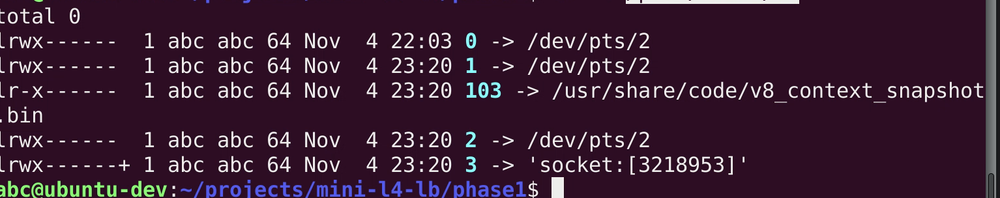

3번 파일디스크립터가 정확히 socket socket inode를 바라보고 있다.

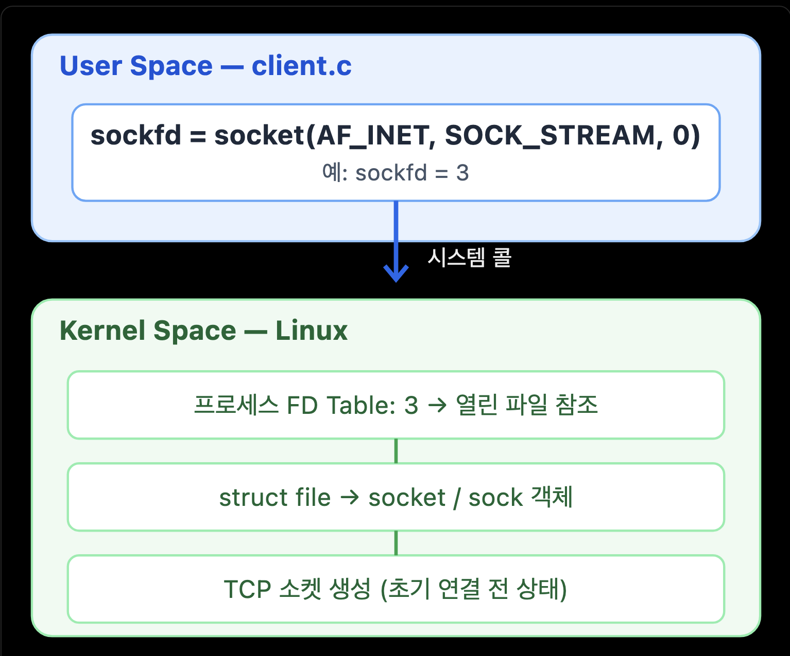

### 3. memset()으로 socket_addr 구조체 초기화

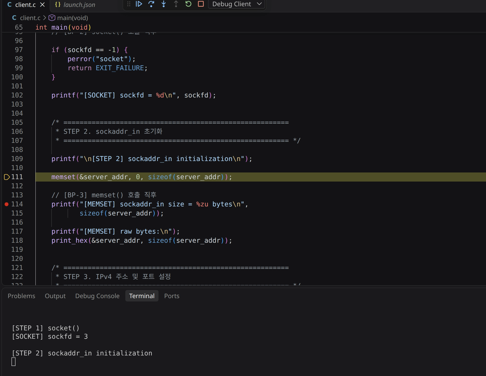

memset(&server_addr, 0, sizeof(server_addr));

이 코드는 server_addr 구조체가 차지하는 메모리 영역 전체를 0으로 초기화하는 코드이다.

현재 TCP Client에서 connect() 를 호출하기 전에 서버의 IP 주소와 포트를 설정하기 위해 사용한다.

memset의 코드 원형

```c
#include <string.h>

void *memset(void *s, int c, size_t n);
```

| 인자 | 현재 코드 | 의미 |
| --- | --- | --- |
| s | &server_addr | 초기화할 메모리의 시작 주소 |
| c | 0 | 각 바이트에 채울 값 |
| n | sizeof(server_addr) | 초기화할 메모리 크기(바이트) |

&server_addr은 구조체 변수의 첫번째 메모리 주소를 가져온다. 자료형은`struct sockaddr_in *`이며, `memset()`을 호출할 때 `void *`로 암시적 변환된다.

두 번째 인자인 0은 구조체의 모든 메모리 영역을 0x00으로 채운다. 세 번째 인자인 size_of(server_addr)은

구조체가 차지하는 전체 크기를 바이트 단위로 반환한다.

일반적인 Linux IPv4 환경에서 struck_sockaddr_in *은 16바이트이다.

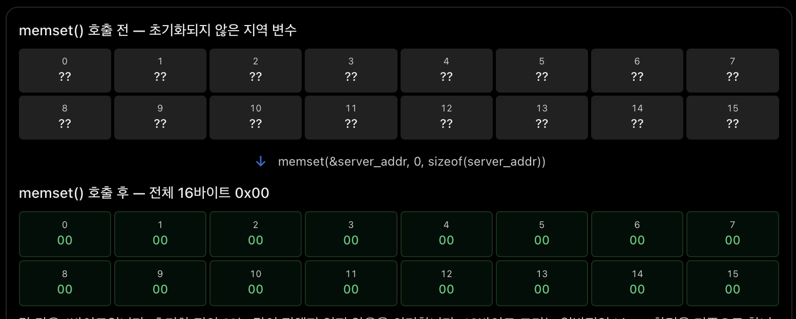

이후에 ip,port, addr등의 값들이 들어가는 구조체이다. 일반적인 Linux 환경에서 구조체의 메모리 배치는 다음과 같다.

| 오프셋 | 필드 | 크기 | 역할 |
| --- | --- | --- | --- |
| 0~1 | `sin_family` | 2바이트 | 주소 체계 |
| 2~3 | `sin_port` | 2바이트 | 포트 번호 |
| 4~7 | `sin_addr` | 4바이트 | IPv4 주소 |
| 8~15 | `sin_zero` | 8바이트 | 패딩 영역 |

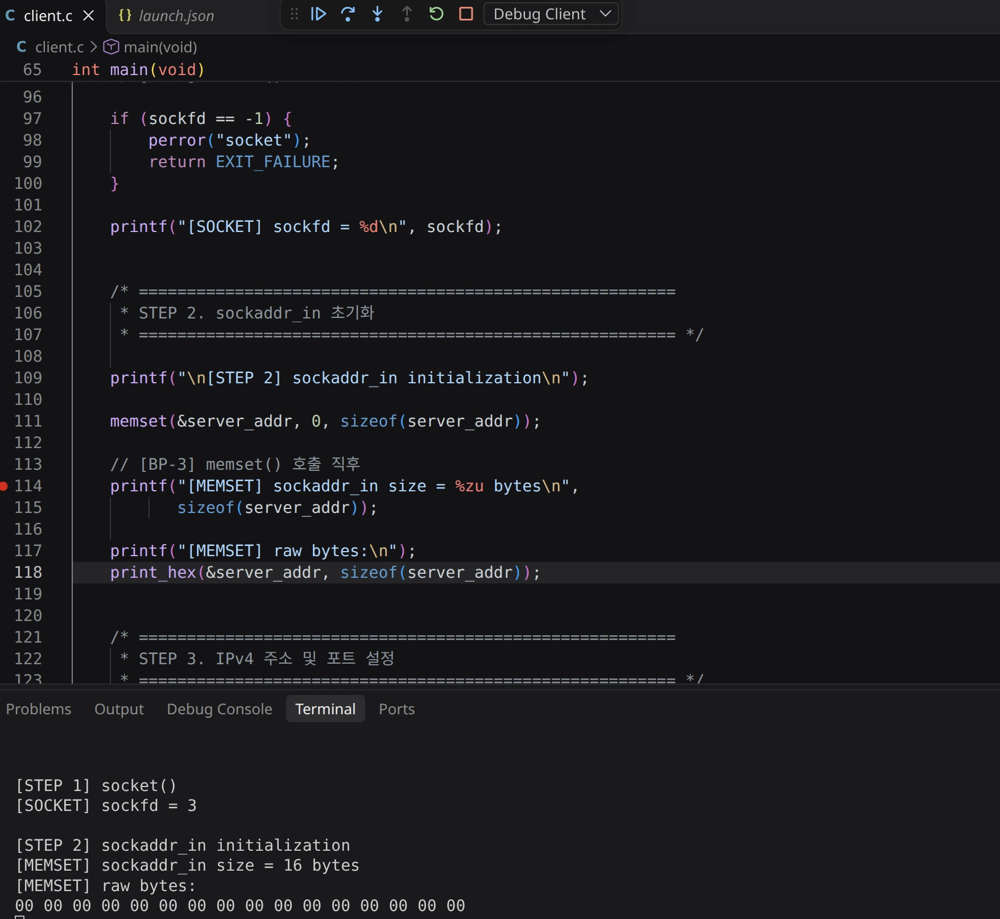

server_port 9090을 host_port 변수에 할당한다. server_port는 2바이트로써 16비트에 해당한다. htons()는 Host TO Network Short의 약자이며, 16비트 정수를 호스트 바이트 순서에서 네트워크 바이트 순서(Big Endian)로 변환한다.

u_int16_t host_port = SERVER_PORT; 

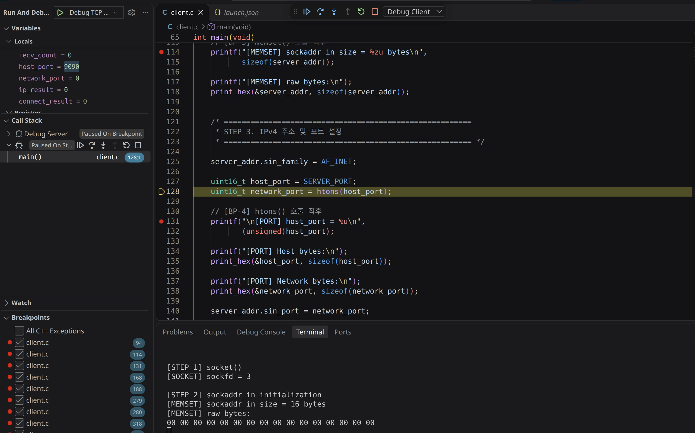

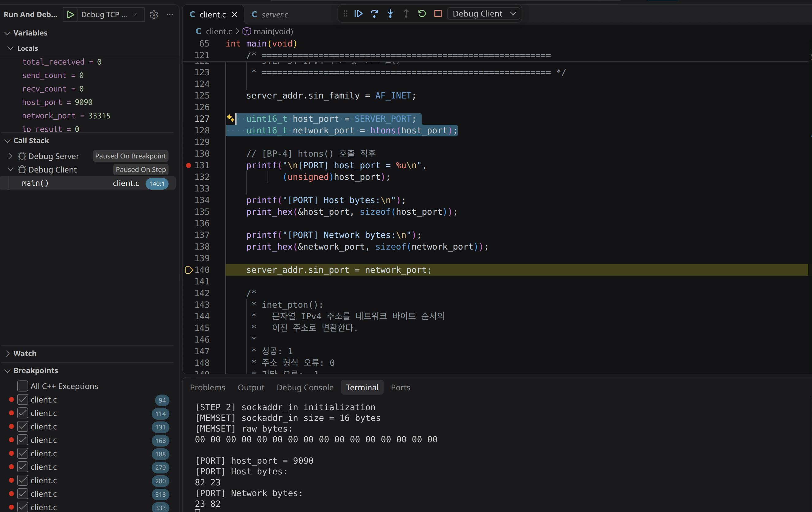

htons() 를 호출하여 포트번호를 변경한 결과를 10진수와 16진수로 나타내면 다음과 같다.

9090 (10진수)
↓
0x2382 (16진수)
↓ htons()
0x8223 (16진수)
↓
33315 (10진수)

### 4. inet_pton() 호출.

```plain text
int ip_result = inet_pton(
    AF_INET,
    SERVER_IP,
    &server_addr.sin_addr
);
```

이 코드는 문자열로 표현된 IPv4 주소(`"127.0.0.1"`)를 네트워크 바이트 순서의 32비트 바이너리 주소로 변환하여 `server_addr.sin_addr`에 저장한다. 변환이 성공적이면 ip_result에 1이 담기고 실패하면 -1을 반환한다.

inet_pton()의 원형 

```c
#include <arpa/inet.h>

int inet_pton(
int af,                // IPv4 주소 체계
const char *src,       // 문자열 형태의 IP 주소
void *dst              // 변환된 주소를 저장할 메모리 위치
);
```

 

                                                                  “127.0.0.1”  문자 9개 + 널 종료 문자

```c
0     1     2     3     4     5     6     7     8     9
31    32    37    2E    30    2E    30    2E    31    00  (ASCII 바이트 16진수)

                               ↓ inet_pton(AF_INET, ...)

                               
														7F    00    00    01					변환 후 IPv4 네트워크 주소(4바이트)
														127   0     0     1
```

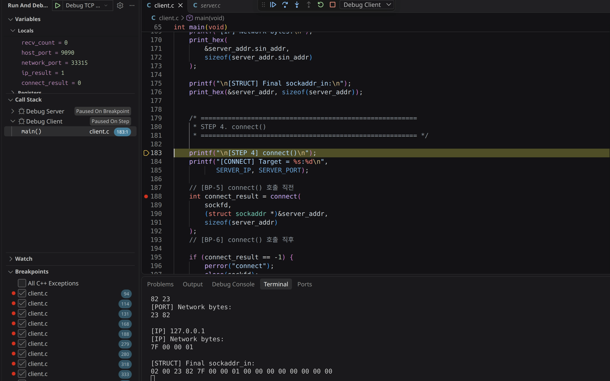

Final sockaddr_in이 아래와 같이 촉기화된것을 확인할 수 있다.

02      00     23    82     7F     00      00       01          00 00 00 00 00 00 00 00

sin_family   9090         127   0         0         1            패딩 영역

이를 해석하면 IPv4 127.0.0.1 port 9090 이다.

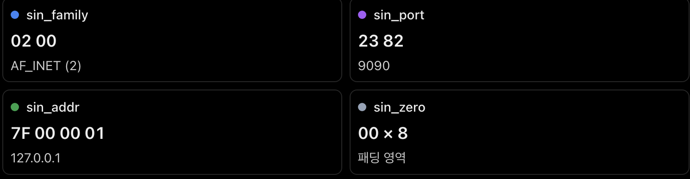

| 바이트 위치 | 필드 | 메모리 값 | 해석 |
| --- | --- | --- | --- |
| 0–1 | `sin_family` | `02 00` | `AF_INET = 2` |
| 2–3 | `sin_port` | `23 82` | 포트 `9090` |
| 4–7 | `sin_addr` | `7F 00 00 01` | `127.0.0.1` |
| 8–15 | `sin_zero` | `00` × 8 | 초기화된 패딩 |

### 5. connect() 호출

`connect()`는 sockaddr_in 16바이트 주소 구조체를 이용해 연결할 목적지를 식별하고 목적지 패킷을 만든다. connect()가 호출되는 타이밍에 syn 패킷이 나가게 된다. 아래는 connect() 시점에 캡쳐한 와이어셔크이다. 미리 서버를 9090 포트에서 bind() → listen() 시켜뒀기 때문에 syn패킷을 받으면 server에서는 accept()를 호출하고 3-way handshake가 맺어진다.

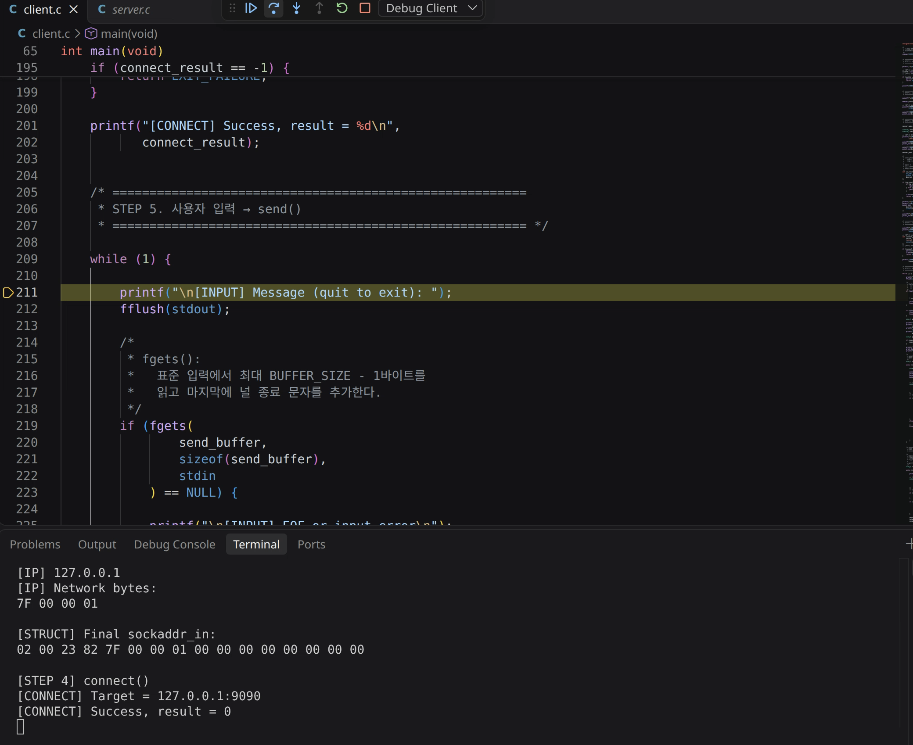

sever.c

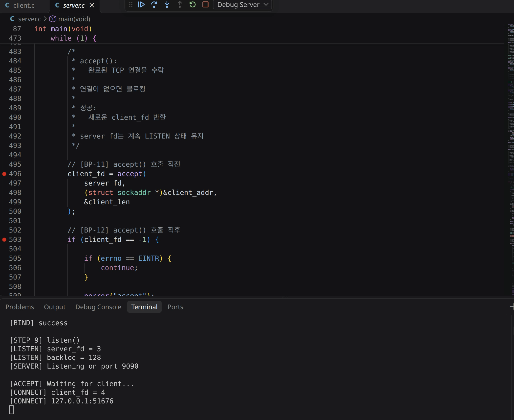

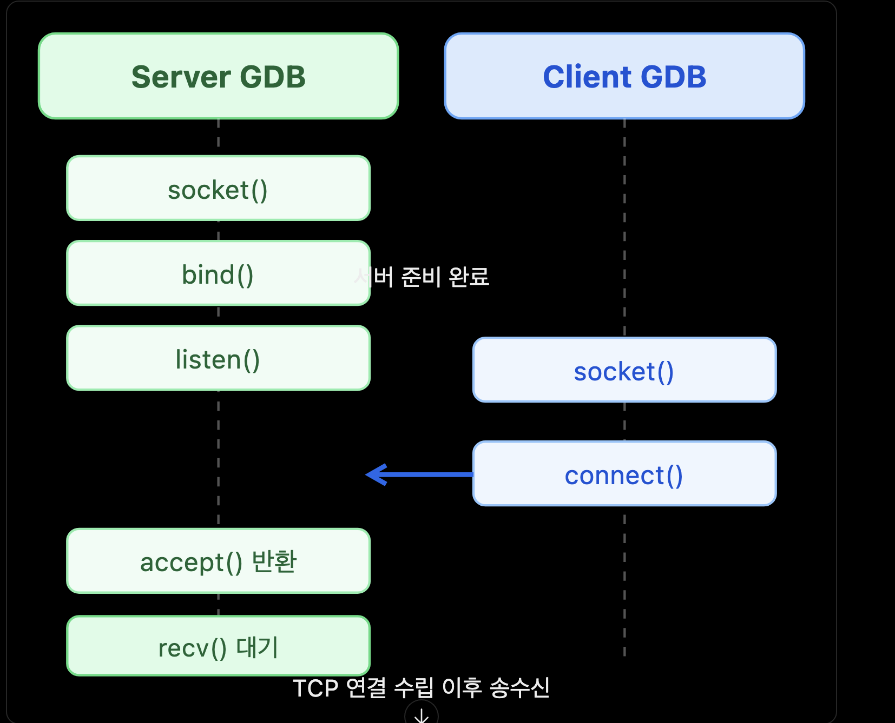

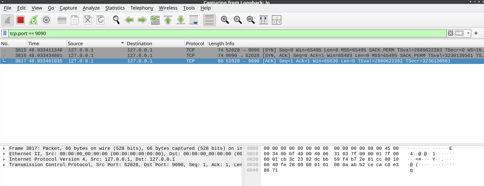

client 반복문이 실행되고

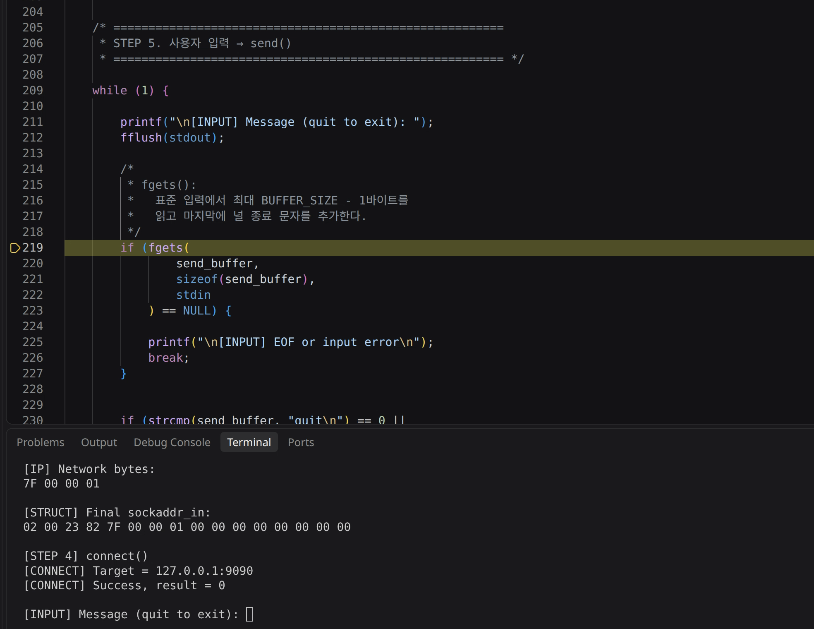

TCP Client에서 사용자로부터 메시지를 입력받고, 입력된 문자열을 `send_buffer`에 저장하는 부분이다.

아직 `send()`를 호출하지 않았기 때문에 네트워크로 데이터가 전송되는 단계는 아니다. `fflush(stdout)`는 아직 출력되지 않은 데이터를 출력 대상으로 내보내도록 요청한다.

### 6. main while문 시작. fgets() — 표준 입력 읽기

함수 원형은 다음과 같다.

```plain text
char *fgets(char *str, int n, FILE *stream);
```

현재 코드는 다음과 같다.

```plain text
fgets(
    send_buffer,
    sizeof(send_buffer),
    stdin
);
```

| 인자 | 전달값 | 의미 |
| --- | --- | --- |
| `str` | `send_buffer` | 데이터를 저장할 배열의 시작 주소 |
| `n` | `sizeof(send_buffer)` | 읽기 버퍼 크기 |
| `stream` | `stdin` | 표준 입력 스트림 |

```plain text
char send_buffer[4096];
```

이 경우 `fgets()`는 최대 4095바이트까지 입력 데이터를 읽고 마지막에 `'\0'`을 추가한다.

단, 줄바꿈 문자 `'\n'`도 입력 길이에 포함된다.

Hello TCP! 문자를 쉘에 입력.

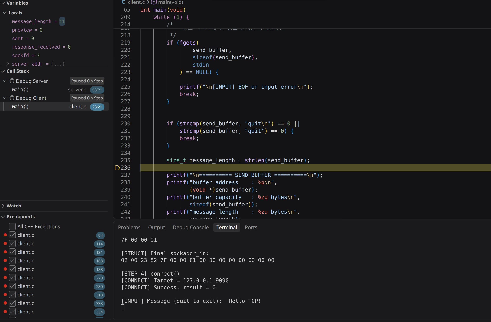

message_length 변수에 11바이트가 기록된다.

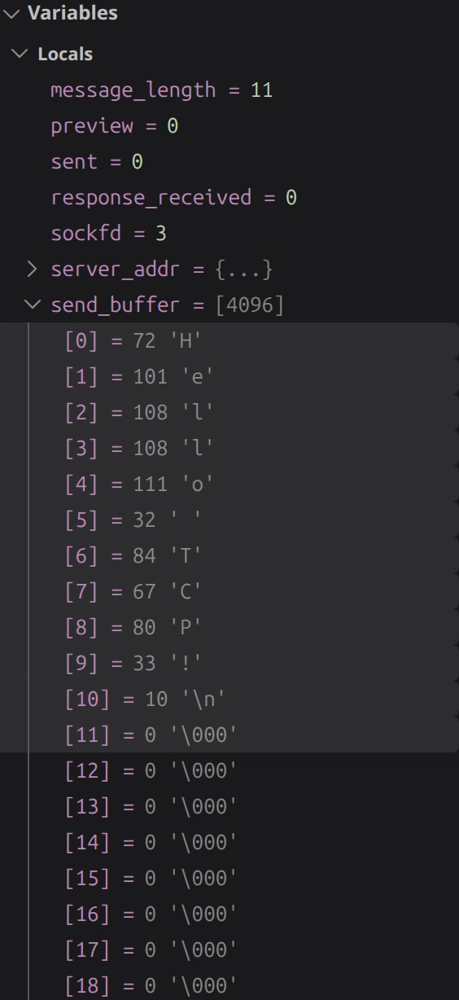

```c
send_buffer 4096 — 처음 12바이트
0     1    2    3   4   5    6    7   8  9   10   11
H     e    l    l   o   sp   T    C   P  !   \n   \0
48    65   6C   6C  6F  20   54   43  50 21  0A   00

```

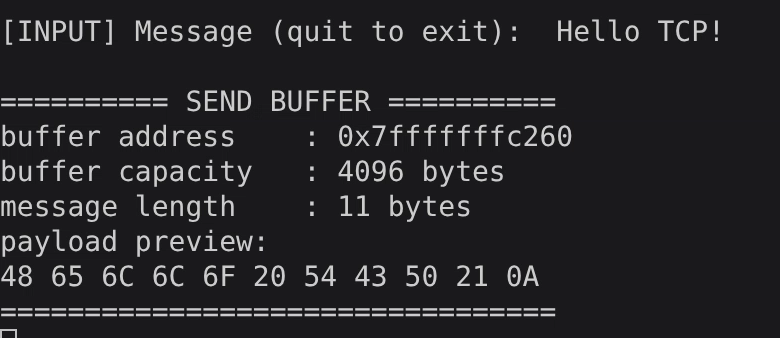

입력된 문자 10바이트 + enter에 해당하는 줄바꿈 1바이트 + 널 종료문자 1바이트 

```c
        size_t sent = 0;

        while (sent < message_length) {

            size_t remaining = message_length - sent;

            printf("\n[DEBUG] Before send()\n");
            printf("send offset       : %zu\n", sent);
            printf("remaining bytes   : %zu\n", remaining);
            printf("send address      : %p\n",
                   (void *)(send_buffer + sent));
```

while 문안에서 다시 while문이 현재 입력된 길이 보다 보낸 바이트가 적을때까지 보낸다. 서버가 Echo 방식으로 정확히 11바이트를 돌려준다고 해도, 클라이언트의 `recv()` 한 번이 반드시 11바이트를 반환하는 것은 아니다. tcp는 바이트 스트림이기 때문에 여러 recv()에 걸쳐 바이트를 읽어들일 수 있다. 또한 recv()의 세번째 인자에 건네진 4096바이트 크기의 버퍼는 최대 한번에 수신할수 있는 바이트 크기를 선언한것이지, 4096바이트씩 끊어서 읽어들인다는것이 아니다.

실제 수신량은 주로 다음에 영향을 받는다.

- `recv()` 호출 시점에 커널 수신 큐에 읽을 수 있는 데이터가 얼마나 있는지

- TCP 데이터가 언제 도착하고 어떻게 분할·병합되는지

- 소켓이 Blocking인지 Non-blocking인지

- `recv()`에 지정한 버퍼 크기와 플래그

특히 TCP 세그먼트 경계와 `recv()` 호출 경계는 일치하지 않는다. 서버가 `send()`를 한 번 호출했다고 클라이언트가 `recv()`를 한 번 호출해 같은 크기를 읽는 것도 아니다.

입력된 길이 에서 send()로 전송한 바이트수를 빼서 remaining에 기록한다. remaining은 아직 전송하지 못한 바이트를 기록하기 위한 변수이다.

예를들어 현재 11바이트 문자를 입력받고 send는 아직 호출하지 않았으니 sent = 0 이다. message_length(11 byte)에서 - 0 byte니까 remaining은 11이 된다. 

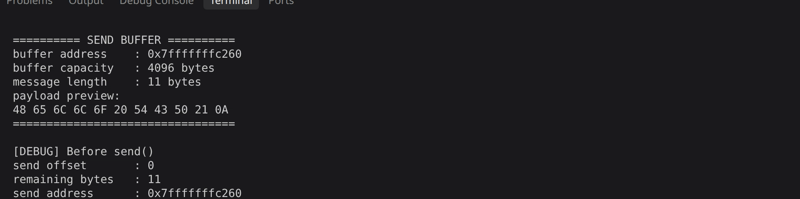

### 7. send() 호출 

```c
  ssize_t n = send(
      sockfd,
      send_buffer + sent,
      remaining,
      0
  );
```

이 코드는 `send_buffer`에 저장된 데이터 중 아직 전송하지 못한 부분을 TCP 소켓으로 전달하고, 이번 `send()` 호출에서 처리된 바이트 수를 `n`에 저장하는 코드이다. 특히 중요한 부분은 `send_buffer + sent`와 `remaining` 이다. 이 두 인자를 통해 부분 전송(Partial Send) 상황을 처리할 수 있다.

-  send() 함수 원형

```plain text
#include <sys/socket.h>

ssize_t send(
    int sockfd,
    const void *buf,
    size_t len,
    int flags
);
```

| 인자 | 현재 코드 | 의미 |
| --- | --- | --- |
| `sockfd` | `sockfd` | 데이터를 보낼 TCP 소켓의 FD |
| `buf` | `send_buffer + sent` | 이번에 전송할 데이터의 시작 주소 |
| `len` | `remaining` | 전송을 요청할 바이트 수 |
| `flags` | `0` | 추가 송신 옵션 없음 |
| 반환값 | `n` | 실제로 처리된 바이트 수 또는 오류 |

`send_buffer`는 배열의 시작 주소로 변환되어 사용되고, `sent`는 이미 전송된 바이트 수이다.

```plain text
send_buffer + sent
```

는 다음과 같다.

```plain text
&send_buffer[sent]
```

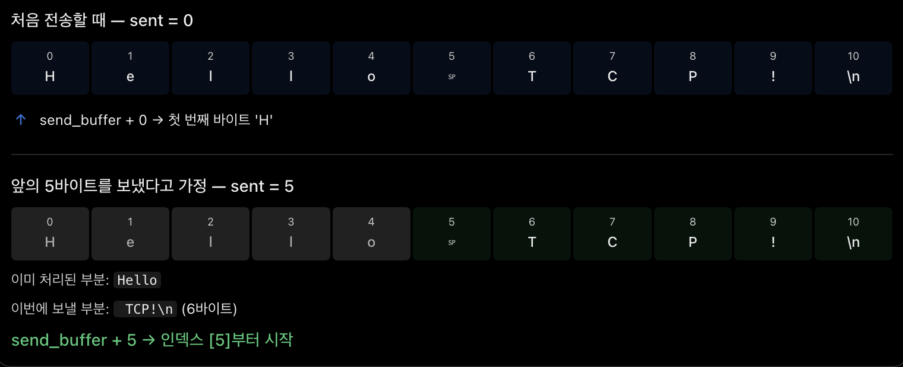

따라서 `sent`가 5라면

```plain text
send(sockfd, send_buffer + 5, 6, 0);
```

이 호출은 `send_buffer[5]`부터 최대 6바이트를 소켓으로 전달하도록 요청한다.

send() 호출후 wirresharrk를 관측한다. 아래 바이트가 전송된것을 확인할 수 있다.

H     e    l    l   o   sp   T    C   P  !   \n   \0
48    65   6C   6C  6F  20   54   43  50 21  0A   00

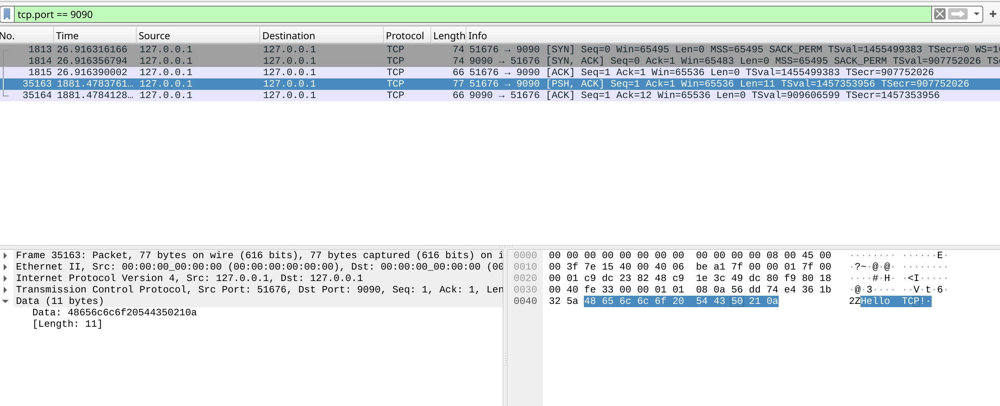

### 8. 서버측 recv()호출

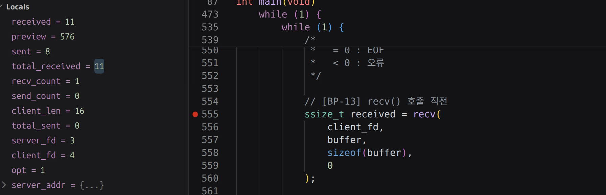

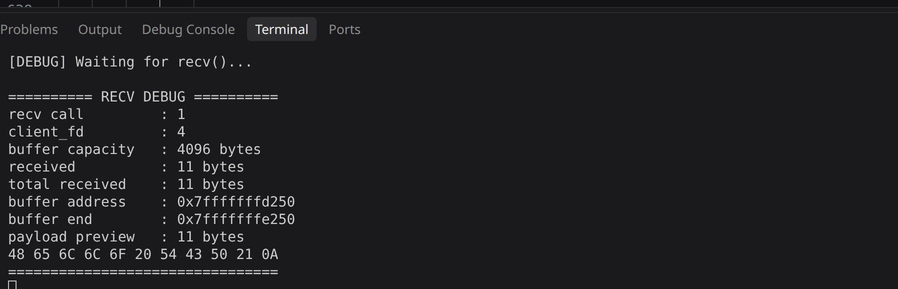

### 9. 서버측 echo send() 호출

서버는 recv()로 수신한 데이터를 그대로 client에게 돌려준다. send() 코드는 클라이언트와 동일하며 9090 서버 → 51676 클라이언트로 Hello TCP!\n 를 응답하는것을 와이어샤크로 확인할 수 있다.

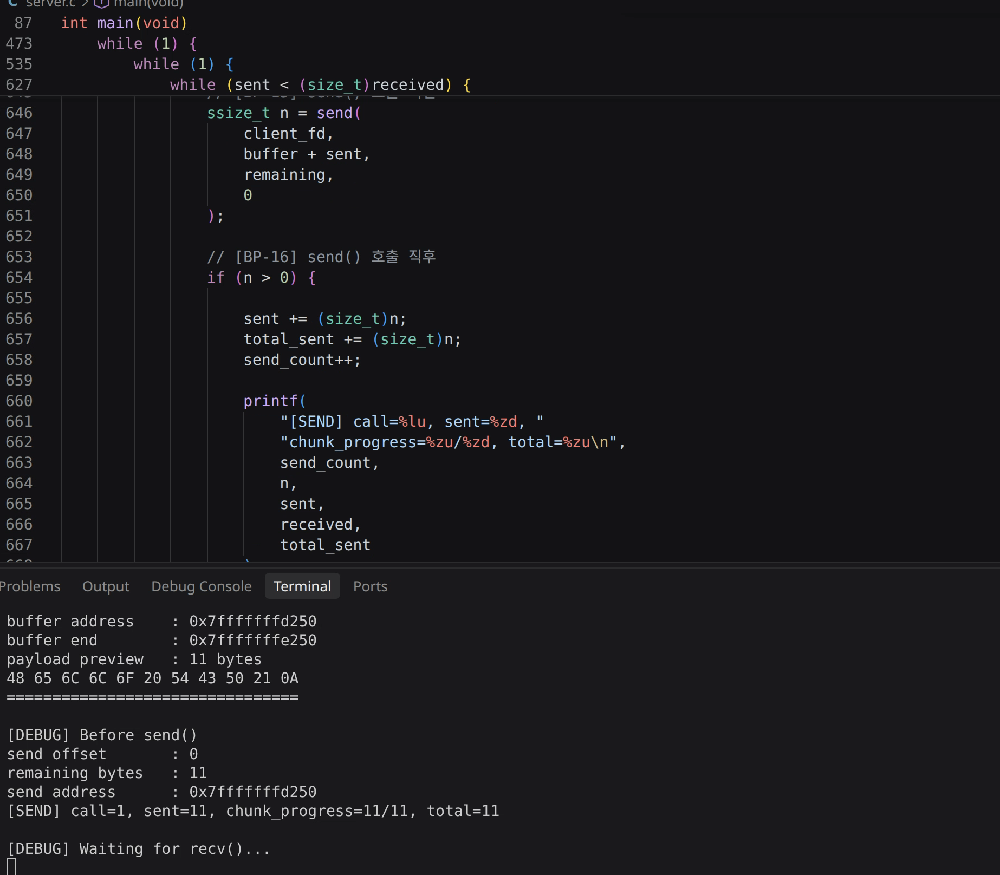

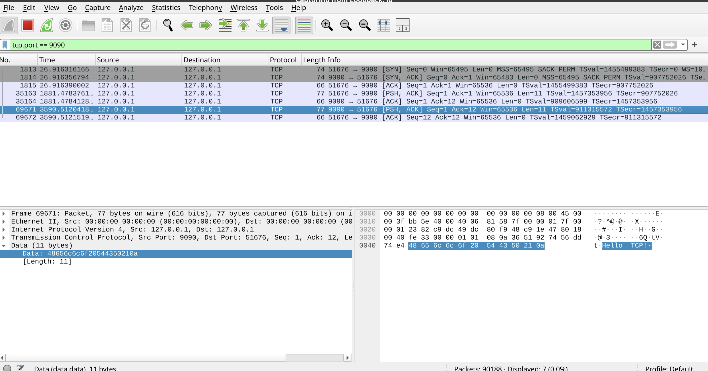

### Phase 2로 확장할 때의 과제

- 현재 구현은 단일 클라이언트씩 처리하는 Blocking Echo 서버이며 아직 Load Balancer가 아니다.

- 다음 단계: non-blocking FD 설정(fcntl), EAGAIN/EWOULDBLOCK, epoll_create1/epoll_ctl/epoll_wait, 클라이언트별 읽기·쓰기 버퍼, EPOLLOUT 및 부분 송신 처리.

- 프록시 단계: listener → downstream client socket → upstream backend socket 구성 및 양방향 relay.

- 실서비스 수준에서는 타임아웃, 시그널 기반 정상 종료, 메모리·FD 제한, 과부하 보호 및 테스트 자동화가 추가로 필요하다.

원본: [Notion](https://app.notion.com/p/Mini-L4-Load-Balancer-C-Linux-epoll-TCP-1-TCP-Echo-server-40caa16a5aa480f4b254c8a996e6c193)
