## 1. 실습 환경과 기록 방법

범위는 **XSS - Reflected (Eval)**, **XSS - Stored (Cookies)**, **XSS - Reflected (AJAX/JSON)** 세 가지로 제한한다. AJAX/XML은 이번 글에서 제외한다.

- 환경: Kali Firefox/Burp → bee-box bWAPP, 기본 주소 `http://192.168.20.205/bWAPP/`

- Security Level을 Low로 설정한다. 각 시나리오가 끝나면 같은 입력으로 Medium·High의 응답과 처리 코드를 비교한다.

- 아래는 실행 가이드이며 실제 성공 여부는 아직 기록하지 않았다. 설치본의 코드와 Network 요청을 기준으로 판단한다.

- 캡처 순서: 정상 동작 → 테스트 요청 → 응답 → 실행 화면 → 원인 코드 → 방어 후 재검증.

- Burp 사용 시 Proxy listener와 Firefox 프록시 포트를 맞춘다. 요청이 멈추면 Intercept를 끄거나 Forward한다.

## 2. Reflected (Eval) — URL 입력이 JavaScript로 실행되는 과정

### 정상 요청 확인

메뉴에서 XSS - Reflected (Eval)을 선택한다. 기본 요청의 date 값을 확인한다.

```plain text
http://192.168.20.205/bWAPP/xss_eval.php?date=Date()
```

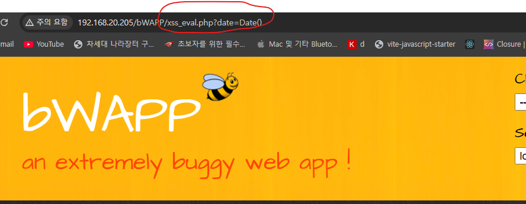

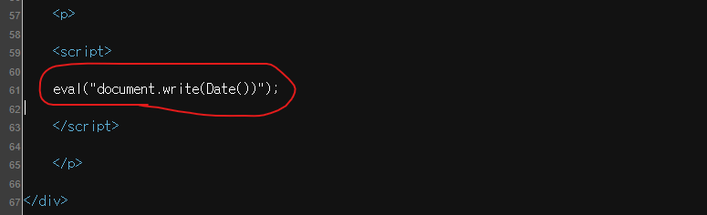

Network의 HTML 응답과 xss_eval.php에서 date가 들어가는 위치를 찾는다. 다음과 같은 구조라면 PHP가 입력을 JavaScript 코드 문자열에 삽입하고, 브라우저의 eval이 이를 실행한다.

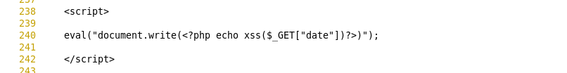

```php
eval("document.write(<?php echo xss($_GET["date"])?>)");
```

이 eval은 브라우저의 JavaScript 함수다. PHP eval 실행이나 서버 명령 실행과 구분한다.

### 테스트

주소창에서 date 값을 아래처럼 바꾸어 접속한다.

```plain text
http://192.168.20.205/bWAPP/xss_eval.php?date=alert(101)
```

응답에 다음 구조가 만들어지는지 확인한다.

```javascript
eval("document.write(alert(101))");
```

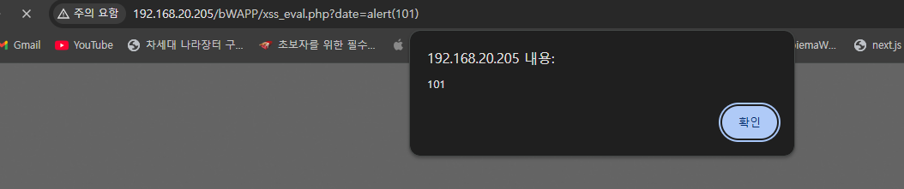

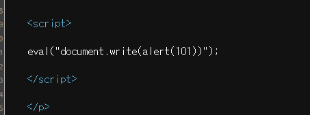

alert(101)이 먼저 실행되고 반환값이 document.write에 전달된다. 화면에 undefined가 나타날 수 있다. 이미 JavaScript 표현식 문맥이므로 script 태그를 붙일 필요가 없다.

high level 설정 후


 xss_eval.php의 코드

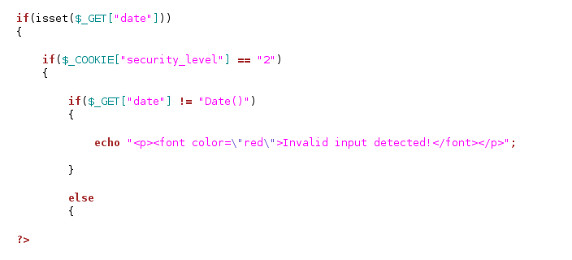

코드는 `date`라는 이름인지 검사하는 것이 아니라, **그 안의 값이 정확히 ****`Date()`****인지 검사한다.**

```plain text
if($_GET["date"] != "Date()")
```

따라서 정상·차단 테스트를 한 쌍으로 진행하면 된다.

| 테스트 | 요청 | High 예상 결과 |
| --- | --- | --- |
| 정상 입력 | `?date=Date()` | 검증 통과 → `xss()` 호출 → 날짜 출력 |
| 비허용 입력 | `?date=alert(101)` | 검증 실패 → 함수 호출 전 차단 |
| 다른 날짜 표현식 | `?date=Date.now()` | 날짜 관련 표현식이어도 허용값과 달라 차단 |

## 3. Stored (Cookies) — 쿠키 저장 후 다른 페이지에서 실행

### 정상 요청과 저장 위치 확인

XSS - Stored (Cookies), xss_stored_2.php에서 장르를 선택하고 Like를 누른다.

1. Network에서 genre 파라미터를 확인한다.

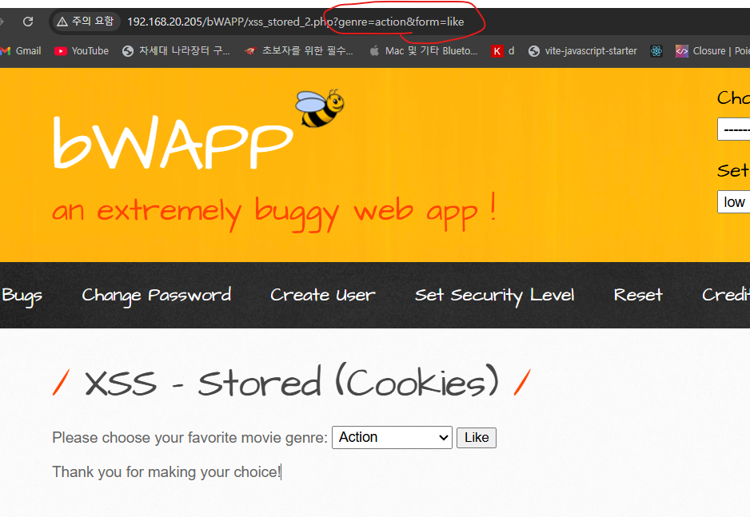

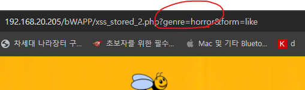

2. 응답의 Set-Cookie와 chrome browser Storage → Cookies 값 확인

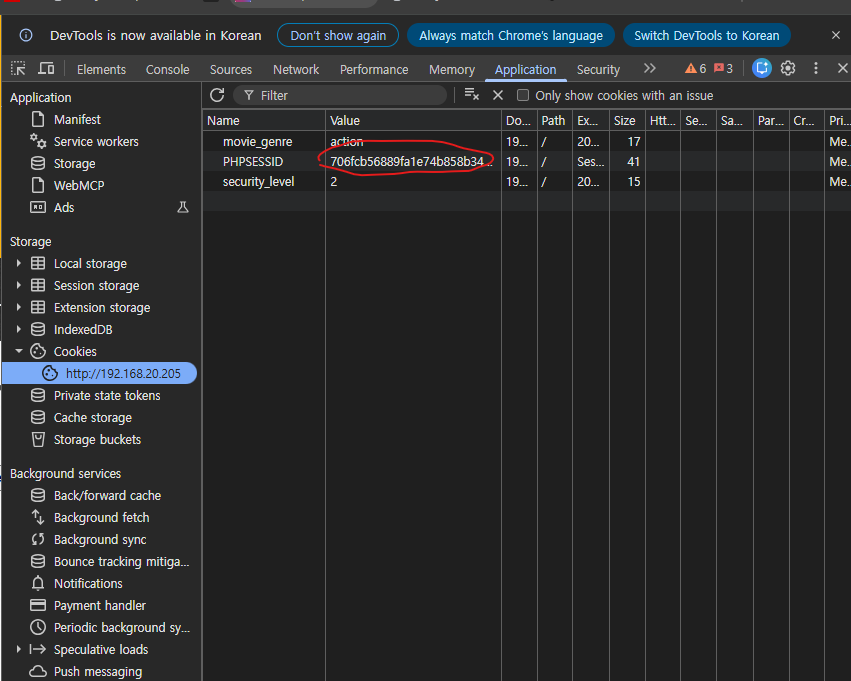

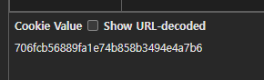

coockie값 출력

```sql
http://192.168.20.205/bWAPP/xss_eval.php?date=alert(document.cookie)
```

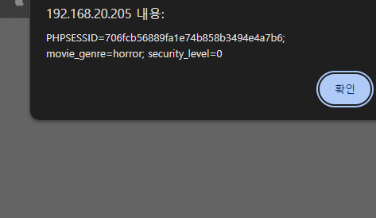

### 테스트 값 저장

장르를 선택했을 때의 실제 요청을 Burp Repeater로 보내거나 주소창에서 genre 값을 수정한다. 아래 URL의 action 값은 자신의 정상 요청에 존재할 때 그대로 유지한다.

```plain text
http://192.168.20.205/bWAPP/xss_stored_2.php?genre=%3Cscript%3Ealert(202)%3C%2Fscript%3E&action=go
```

저장할 원래 값은 다음과 같다.

```html
<script>alert(202)</script>
```

Repeater 응답의 Set-Cookie는 브라우저에 자동 반영되지 않는다. 브라우저에서 해당 요청을 보내거나 Proxy에서 실제 요청을 수정해야 브라우저 쿠키에 저장된다.

### 방어와 정리

장르는 허용된 값만 저장하도록 검증하고, 쿠키 값을 HTML 본문에 표시할 때 출력 인코딩을 적용한다.

```php
echo htmlspecialchars($value, ENT_QUOTES, 'UTF-8');
```

웹 방어는 모두 htmlspecialchars를 통해, 명령어나 코드로 해석되지 않게 일반 문자열로 처리하게 한다. 현재 코드에서는 script 태그를 script로 해석하지 않게 엔터티로 변환한다. 간단하면서도 강력한 방법이다.

| 의미 | 문자 | 엔터티 이름 (Name) | 엔터티 코드 (Decimal) |
| --- | --- | --- | --- |
| 공백 |   (띄어쓰기) | &nbsp; | &#160; |
| 앰퍼샌드 | & | &amp; | &#38; |
| 작은 따옴표 | < | &lt; | &#60; |
| 큰 따옴표 | > | &gt; | &#62; |
| 따옴표 | " | &quot; | &#34; |
| 작은 따옴표 | ' | &apos; (HTML5 권장) | &#39; |

** <script>alert("test1")</script> → **&lt;script&gt;alert(&quot;test1&quot;)&lt;/script&gt;

high level 설정후

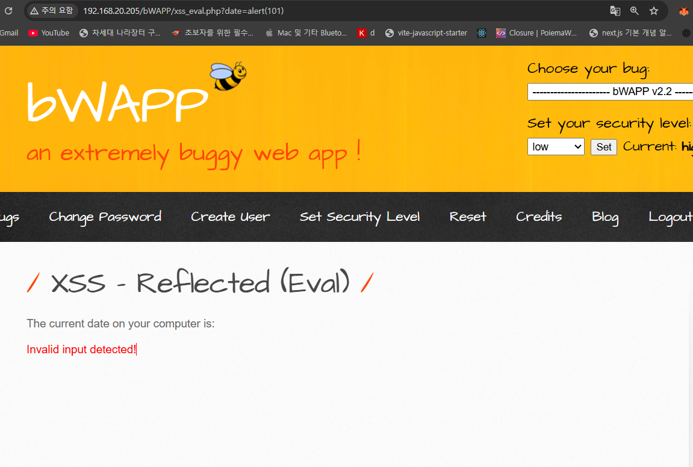

### HttpOnly의 핵심 기능

HttpOnly가 설정된 쿠키는 **오직 HTTP(또는 HTTPS) 요청을 통해서만 전송된다**

자바스크립트의 document.coockie 코드를 사용해 해당 쿠키에 접근하거나 읽어오는 행위가 **전면 차단된다. **브라우저가 서버와 통신(예: 로그인 상태 유지, 세션 ID 전송 등)할 때 HTTP 요청 헤더에 자동으로 쿠키가 포함되어 전송되는 기능은 정상적으로 작동한다. 

## 4. Reflected (AJAX/JSON) — 비동기 응답에서 DOM까지 추적

### 정상 AJAX 요청 확인

XSS - Reflected (AJAX/JSON), xss_ajax_2-1.php를 선택한다. Firefox Network에서 XHR 요청을 필터링하고 영화명을 입력한다.

- 입력에 따라 발생하는 xss_ajax_2-2.php 요청과 title 파라미터를 확인한다.

- 정상 영화명과 존재하지 않는 표식 XSS303을 비교한다.

- 응답 Content-Type, JSON 구조, 입력값이 반영되는 필드를 확인한다.

- 주소창이 그대로여도 Network에는 비동기 요청이 나타난다.

**입력값을 약 1초(1000ms)마다 서버로 전송**

```javascript
title = encodeURIComponent(document.getElementById("title").value);

xmlHttp.open("GET", "xss_ajax_2-2.php?title=" + title, true);
xmlHttp.send(null);

// 1초 뒤 다음 요청 시작
setTimeout("process()", 1000);
```

입력란의 값이 title 파라미터로 전송된다. encodeURIComponent()는 URL로 전달하기 위한 인코딩이며, XSS 방어 처리는 아니다.

서버 PHP가 다음 중 **하나만 선택해 브라우저에 내려줍니다.**

| 수준 | 브라우저가 받는 코드 | 동작 |
| --- | --- | --- |
| Low·Medium | eval("(" + xmlHttp.responseText + ")") | 응답을 JavaScript 표현식으로 실행 |
| High | JSON.parse(xmlHttp.responseText) | 응답을 JSON 데이터로 파싱 |

### 테스트

영화명 입력란에 다음 값을 넣어 AJAX 요청을 발생시킨다.

```html

```

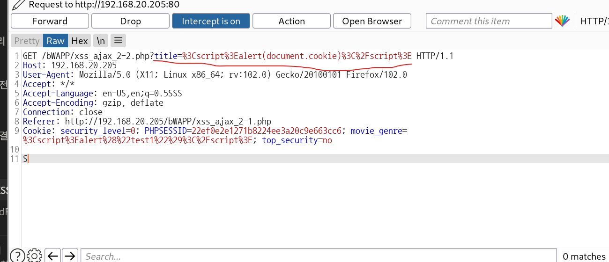

실제 처리 경로를 순서대로 관찰한다.

1. title이 요청 파라미터로 인코딩되어 전송된다.

```javascript
title = encodeURIComponent(document.getElementById("title").value);

encodeURIComponent()
printf(title);  // %3Cscript%3Ealert(document.cookie)%3C%2Fscript%3E 

xmlHttp.open("GET", "xss_ajax_2-2.php?title=" + title, true);
xmlHttp.send(null);

url 파라미터: php?title=%3Cscript%3Ealert(document.cookie)%3C%2Fscript%3E
```

1. **PHP가 파라미터를 읽는다**

서버에서 PHP는 쿼리 값을 URL 디코딩해 제공합니다.

```plain text
$title = $_GET["title"];

title = %3Cscript%3Ealert(document.cookie)%3C%2Fscript%3E
```

따라서 $title은 다시 다음 문자열이 된다.

```plain text

```

**이후 **필터링 없이 응답에 반영한다고 가정하면, 다음 JSON이 반환될 수 있다.

```plain text
{
  "movies": [
    {
      "response": ""
    }
  ]
}
```

1. **브라우저가 응답을 객체로 변환**

```plain text
// 1. 응답을 JavaScript 표현식으로 평가
JSONResponse = eval("(" + xmlHttp.responseText + ")");

// 2. response 문자열 추출
result = JSONResponse.movies[0].response;

// 3. 문자열을 HTML로 해석해 삽입
document.getElementById("result").innerHTML = result;
```

`result`에는 원래 문자열이 들어간다

```plain text

```

1. **`innerHTML`****이 문자열을 실제 HTML 요소로 만든다.**

```plain text
document.getElementById("result").innerHTML = result;
```

브라우저가 ``를 생성하고 `src="x"`의 이미지 로딩을 시도합니다. 로딩이 실패하면 다음 이벤트 코드가 실행된다

```plain text
alert(document.cookie)
```

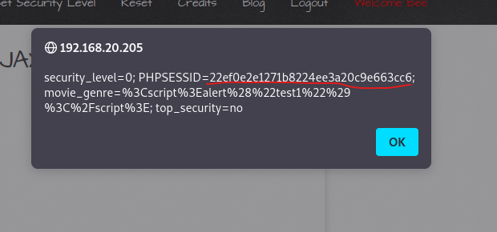

그 결과 **현재 페이지에서 JavaScript로 읽을 수 있는 쿠키**가 경고창에 표시된다. HttpOnly 쿠키는 제외

high level에서의 방어

서버 PHP가 보안 수준을 확인

```plain text
if($_COOKIE["security_level"] == "2")
```

브라우저에는 아래 코드를 내려준다

```plain text
JSONResponse = JSON.parse(xmlHttp.responseText);
result = JSONResponse.movies[0].response;
document.getElementById("result").innerHTML = result;
```

위 응답처럼 태그가 그대로 들어 있다면 이미지 요소가 생성되고, 이미지 로딩 실패 시 alert(document.cookie)를 그대로 문자열로 출력

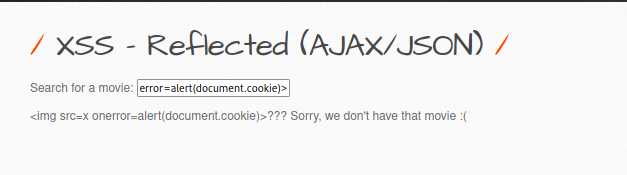

### 방어와 재검증

서버에서는 JSON 직렬화 함수로 응답을 만들고 적절한 JSON Content-Type을 사용한다. 클라이언트에서는 eval 대신 JSON.parse를 사용하고 단순 문구는 textContent로 출력한다. 출력 코드는 실제 응답 구조에 맞춘다.

```javascript
var data = JSON.parse(xhr.responseText);
// response 필드 경로는 설치본의 실제 JSON 구조에 맞춘다.
document.getElementById("result").textContent =
    data.movies[0].response;
```

JSON Content-Type과 JSON.parse만으로 innerHTML 위험이 사라지지는 않는다. 같은 테스트 입력이 텍스트로 표시되고 이벤트가 실행되지 않는지 확인한다.

## 5. 결과 비교

| 시나리오 | 입력·저장 위치 | 실행 지점 | 핵심 개선 | 실습 결과 |
| --- | --- | --- | --- | --- |
| Reflected Eval | URL date | JavaScript eval | 입력을 코드로 실행하지 않기 | 직접 기록 |
| Stored Cookies | genre → movie_genre 쿠키 | 쿠키 출력 페이지의 HTML | 허용값 검증·출력 인코딩 | 직접 기록 |
| Reflected AJAX/JSON | XHR title → JSON 응답 | 응답 처리 코드·DOM 출력 | JSON 직렬화·안전한 파싱·textContent | 직접 기록 |

원본: [Notion](https://app.notion.com/p/bWAPP-XSS-Eval-Cookies-AJAX-JSON-413aa16a5aa481b2bf02ec358bef7440)
